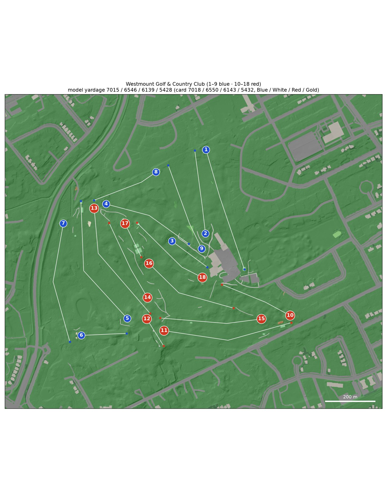
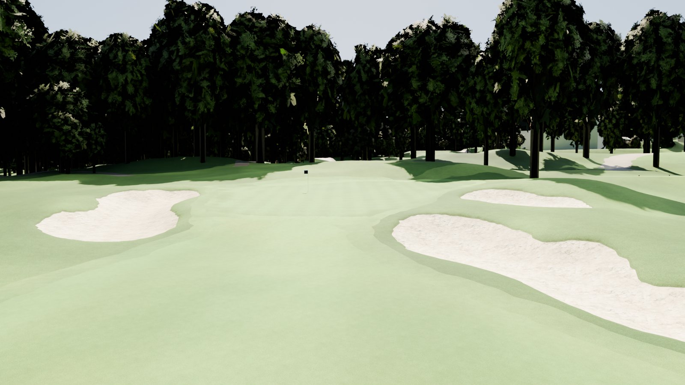
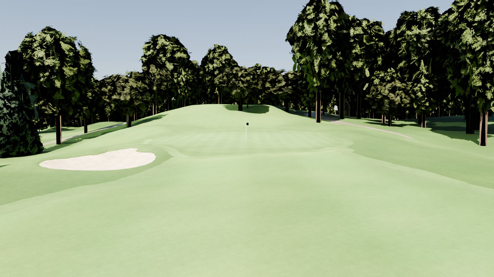
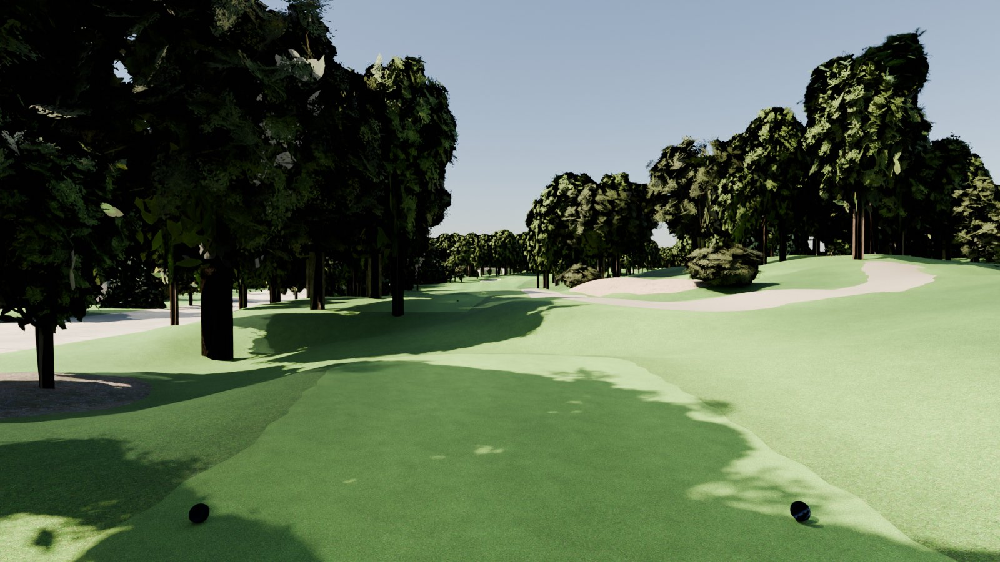

# Westmount Golf & Country Club for GSPro

A survey-grade model of [Westmount Golf & Country Club](https://www.westmountgolf.com/) (Kitchener, Ontario; Stanley
Thompson, 1931; par 73) for the [GSPro](https://gsprogolf.com/) golf simulator. It is built end to end from public data:

* Ontario 2018 LiDAR;
* 2025 Ontario orthoimagery;
* OpenStreetMap;
* the Golf Canada scorecard.

The pipeline produces:

* a textured glTF you can explore in the bundled three.js viewer;
* an OPCD / GSPro hand-off package (Unity terrain heightmaps, overlays, OPCD SVG, FBX surface meshes named for
  `SetMeshMaterial.cs`, tree prefabs and placements, GreenKeeper data, 3D-grass masks and a Unity editor helper).

The Windows side (Unity 2018.2 + OPCD + GreenKeeper) is the course designer's job: see
[research/GSPRO_COSMETICS.md](research/GSPRO_COSMETICS.md).



| | |
|---|---|
|  |  |
| Hole 14: approach to the green, between the greenside bunkers | Hole 16: the green on its plateau |
|  | |
| Hole 11 Blue tee: the deck was rebuilt about 2023 and is synthetic over the 2018 terrain | |

*Headless Blender (Cycles) renders of `output/westmount/westmount.glb`. The turf is graded to summer; trees use the
LiDAR-derived archetypes. GSPro renders with its own materials.*

## The course

| Tee | Yards | Men rating / slope | Women rating / slope |
|---|---|---|---|
| Blue | 7,018 | 73.0 / 132 | – |
| White | 6,550 | 71.1 / 129 | 76.9 / 135 |
| Red | 6,143 | 69.3 / 121 | 75.1 / 130 |
| Gold | 5,432 | 66.3 / 113 | 71.3 / 121 |

Par 73 (37 out / 36 in). Source: Golf Canada Score Centre (live 2026-10-11). It was cross-checked against the club's
cards and Wayback captures by an adversarial verifier; see [courses/westmount/research/NOTES.md](courses/westmount/research/NOTES.md). The combination sets
(Blue/White 6,732, White/Red 6,322, Red/Gold 5,814) reuse these four boxes.

Per hole, as modelled. Tee columns give the measured yards (GreenKeeper's rule: tee → aim points nearer the green →
green centre), with the card yards in brackets where they differ by more than 6 yd. None does: every tee is within
6 yd of the card, and 69 of 72 are within 3 yd.

<!-- holes-table -->
| Hole | Par | SI | Blue | White | Red | Gold | Green (yd deep × wide) | Elev. change | Hazards |
|---|---|---|---|---|---|---|---|---|---|
| 1 | 5 | 7 | 559 | 535 | 514 | 435 | 40 × 24 | -6 m | 6 bunker |
| 2 | 4 | 13 | 373 | 357 | 335 | 286 | 48 × 18 | +10 m | 2 bunker |
| 3 | 3 | 9 | 195 | 179 | 163 | 160 | 28 × 28 | -8 m | 2 bunker, 1 native_area, 1 water |
| 4 | 4 | 1 | 415 | 386 | 367 | 323 | 32 × 25 | -6 m | 3 bunker, 1 water |
| 5 | 5 | 3 | 600 | 568 | 527 | 450 | 42 × 29 | +5 m | 4 bunker |
| 6 | 3 | 15 | 202 | 180 | 163 | 133 | 32 × 32 | -8 m | 5 bunker |
| 7 | 5 | 11 | 541 | 503 | 480 | 449 | 41 × 26 | -8 m | 4 bunker |
| 8 | 4 | 17 | 305 | 275 | 260 | 245 | 27 × 24 | +2 m | 5 bunker |
| 9 | 4 | 5 | 401 | 373 | 346 | 334 | 35 × 19 | +6 m | 2 bunker, 1 water |
| 10 | 4 | 12 | 334 | 319 | 304 | 217 | 29 × 32 | -3 m | 2 bunker, 4 native_area |
| 11 | 5 | 6 | 580 | 540 | 502 | 451 | 37 × 24 | +0 m | 2 bunker, 1 native_area |
| 12 | 3 | 18 | 141 | 127 | 108 | 93 | 32 × 27 | -6 m | 3 bunker |
| 13 | 5 | 8 | 554 | 520 | 503 | 439 | 35 × 28 | -6 m | 2 bunker |
| 14 | 4 | 10 | 375 | 359 | 318 | 294 | 29 × 27 | -5 m | 3 bunker |
| 15 | 4 | 2 | 453 | 396 | 367 | 315 | 26 × 28 | +3 m | – |
| 16 | 4 | 4 | 439 | 418 | 400 | 359 | 33 × 28 | -4 m | 1 bunker |
| 17 | 3 | 16 | 165 | 145 | 132 | 113 | 27 × 27 | -5 m | 3 bunker |
| 18 | 4 | 14 | 384 | 367 | 351 | 334 | 36 × 26 | +4 m | 1 bunker, 2 native_area |
| **Total** | **73** | | **7015** (7018) | **6546** (6550) | **6139** (6143) | **5430** (5432) | | | |
<!-- /holes-table -->

## Data

| Input | Source | Licence |
|---|---|---|
| Terrain, trees | OMAFRA Lidar 2016-18 (Lake Erie package), flown March 2018 leaf-off, 14-20 pts/m2; NRCan CanElevation COPC tiles | Open Government Licence – Ontario / – Canada |
| Imagery | SWOOP 2025 (Geospatial Ontario), 16 cm, R G B + near-infrared, spring 2025 | Open Government Licence – Ontario |
| Backdrop terrain, trees | NRCan HRDEM 1 m DTM and DSM (same 2018 survey) | Open Government Licence – Canada |
| Course features | OpenStreetMap (holes, greens, fairways, tees, bunkers, water, buildings, roads) | ODbL |
| Scorecard | Golf Canada Score Centre | facts |

Attribution for anything shipped from this repository: *Contains information licensed under the Open Government
Licence – Ontario* and *– Canada*; *© OpenStreetMap contributors*.

Esri World Imagery and the Region of Waterloo / City of Waterloo orthophotos were deliberately **not** used. Their
licences do not allow derived textures to be redistributed.

## How it was built

The pipeline (`scripts/`, run by `scripts/build_all.py`) comes from the MountainGate course-builder skeleton
([instructions.md](instructions.md)) and was adapted to Ontario:

1. **Research** (multi-agent, `workflows/course_research.js`): scorecard, hole notes and course facts; LiDAR, DEM and
   imagery sources. Every claim was re-checked by an adversarial verifier.
2. **Rasters**: the LiDAR is streamed into 0.25 m DEM, DSM, canopy height and intensity rasters (EPSG:2958, CGVD2013).
3. **Imagery registration**: SWOOP 2025 sits 0.25 m south of the LiDAR (59 bunkers, sand vs hollows).
4. **Cart paths** (`trace_paths.py`, new): OSM maps none at Westmount, so the path centre lines are traced as
   NDVI ridges in the near-infrared photo. NDVI ignores the long tree shadows of the leaf-off photo.
5. **Classification**: a random forest on photo Lab + NIR / NDVI and LiDAR features, trained on OSM labels, then
   vectorised into a gap-free surface partition. LiDAR validation keeps a bunker only if it is a hollow and a tee only
   if it is a flat deck.
6. **Trees** (`detect_trees.py`): about 10,700 LiDAR trees. The leaf-off canopy is closed before segmentation. Conifers
   are told apart from bare hardwoods by pulse penetration and crown NDVI. Archetypes: maple, oak, white pine, spruce,
   shrub, each in five shape variants (height, spread, crown base, lean, clumping) with per-card leaf hue.
7. **Structures**: OSM buildings, plus five shelters and service buildings OSM lacks
   (`courses/westmount/features/structures.geojson`, footprints from LiDAR building returns or the 2025 photo). Roofs follow the
   building-class LiDAR returns (`bdsm.tif`), so the clubhouse keeps its ridges and hips without the crowns of the
   trees that overhang it. A rectangular roof is a gable when a ridge fits its returns better than hips. House walls
   vary between seven colours (white, cream, beige, grey, buff, red and brown brick). The clubhouse restaurant patio
   beside the hole 3 tee (`courses/westmount/features/patios.geojson`) is a paved terrace with tables, chairs and umbrellas. The
   clubhouse lots have parked cars (about 60 % of the stalls), the hole 3 pond has an aerating fountain
   (`courses/westmount/features/fountains.geojson`, placed at the spray visible in the 2025 photo), and the mulch beds round the
   clubhouse and pro shop are traced from the photo (`courses/westmount/features/overrides/clubhouse_mulch.geojson`,
   `grounds_mulch.geojson`).
8. **Mesh**: one conforming constrained Delaunay triangulation with fine triangles in the playing corridors, OPCD
   bunker lips (10 cm) and water objects. It joins a 5 km imagery-draped backdrop without seams. Within 640 m of the
   course the backdrop carries billboard trees at the HRDEM canopy peaks and the OSM buildings at their LiDAR heights
   (`backdrop_objects.py`; viewer and glTF only). Tees built after the 2018 survey (holes 5, 8, 11 and 17, and the new
   hole 14 Gold box) get a synthetic level deck with graded banks.
9. **Hole data**: tee markers are slid along the real tee decks to the card yardages. Pins come from a green-slope
   analysis (<= 3 %, relaxed to <= 5 % on Westmount's steepest greens). Aim points come from the line of play.
10. **QA** (multi-agent, `workflows/hole_qa_round1.js`, `hole_qa_round2.js`; 24 agents in two rounds). Per-hole
    inspectors compare the model with the photo and LiDAR, and adversarial verifiers approve or reject every proposed
    correction.
    * Approved corrections (123 features) live in `courses/westmount/features/overrides/`, with two later additions confirmed in
      review: a path traced by hand (`hole18_paths.geojson`) and the new hole 14 Gold box (`hole14_gold.geojson`).
    * Issues that recurred across holes were fixed in the pipeline, with tests: leaf litter, shadowed sand, path gaps,
      off-course sidewalks, false tees, L-shaped pads, tees newer than the LiDAR, pins on steep greens, missing
      shelters.
    * After round 2 every hole scored 8 or 9 out of 10. The verdicts are in `courses/westmount/research/qa/`.
11. **Export**: glTF, the OPCD package, FBX (headless Blender), maps.

## Rebuilding

Requires Python 3.12, [uv](https://github.com/astral-sh/uv) and headless Blender 4.2 LTS (for the FBX step). On
macOS, Blender opens a Metal device even with `-b`: where the GPU is not reachable (a sandboxed shell, for example) it
crashes at startup, and the `fbx` step has to run outside the sandbox.

Measured on this build:
* **RAM:** 11.5 GB at peak (the classifier). No other step exceeds 5 GB.
* **Disk:** about 4 GB, including the 1.2 GB output package.
* **Time:** about 25 min for all steps on 96 cores. The longest steps are vectorize, rasters, classify and export,
  at about 4-5 min each.
* **On a 32-core, 93 GB runner** (fresh clone, 2026-10-11): about 33 min. The first backdrop run takes 11 min and is
  cached afterwards. Peak memory, sampled every 2 s, was 5.6 GB.
* **On a MacBook Pro (Apple M5 Max, 18 cores, 64 GB, macOS 27.0.1; 2026-10-14)**: about 13 min with the downloads in
  place; vectorize (3 min), rasters and export (2 min each) are the longest steps. Peak memory 8.4 GB (largest single step). The first
  backdrop run downloads its 5 km photo from the LIO image server; that took 84 min on the day, with HTTP 500/502
  responses that the fetch retries.

```bash
uv venv --python 3.12 .venv
uv pip install --python .venv/bin/python -r requirements.txt
.venv/bin/python scripts/fetch_data.py lidar osm imagery   # 590 MB LiDAR + 250 MB imagery
.venv/bin/python scripts/fetch_textures.py
.venv/bin/python scripts/fetch_backdrop.py
BLENDER=/path/to/blender .venv/bin/python scripts/build_all.py      # all steps (about 25 min on 96 cores)
.venv/bin/python -m pytest -q tests                                  # unit + built-course tests
.venv/bin/python scripts/fingerprint.py check                        # the build against courses/westmount/fingerprint.json
# CI (.github/workflows/tests.yml) runs the unit tests only: pytest tests --ignore=tests/test_course.py
python3 scripts/devserver.py 8765   # then open http://localhost:8765/viewer/?v=1#h1-tee
```

`courses/westmount/fingerprint.json` is the golden build fingerprint: a digest of every downloaded input and build
product (GeoTIFFs by pixels and georeference, `.npz` files by their arrays), with readable summaries and the machine,
OS and package versions that produced it. Every engine change must rebuild Westmount to the same fingerprint, or
explain each difference. Floating-point results only match on that machine and package set; `fingerprint.py check`
lists any environment difference before the artefacts. FBX and .blend files are listed, not compared: Blender writes
the time into both and derives FBX object ids from Python's per-process string hash. The glTF they are converted from
and `gspro/fbx_manifest.json` are compared.

`courses/westmount/research/osm_*.json` hold the OSM snapshot the model was built from. Delete them before
`fetch_data.py osm` to refresh.

Each course lives in `courses/<slug>/` (`course.toml`, `features/`, `research/`) and builds into `data/<slug>/`,
`build/<slug>/` and `output/<slug>/`. Set `COURSE=<slug>` once there is more than one course. A checkout made before
the course folders keeps its downloads at the top of `data/`; move them rather than fetching again, so the inputs
stay byte-identical:

```bash
mkdir -p data/westmount && mv data/lidar data/imagery data/dem data/textures data/westmount/
rm -rf build output features/auto_core.geojson features/course_surfaces.geojson features/trees.geojson
```

## Known limitations

* **2018 terrain, newer tees.** The LiDAR predates the rebuilt tees on holes 5 and 11 (about 2023), the 2025 back tee
  on hole 8 and the 2025 boxes on hole 17. Those tees are synthetic level decks at the polygon's mean 2018 height,
  with graded banks; a deck that would sit cut into the slope is built up to a neighbouring deck of the same hole
  instead (hole 8 Blue to the White deck, +1.8 m; hole 17 and hole 14 Gold too). Their real heights are unknown, and
  some banks are 1-2 m. The 2018 trees the 2025 photo shows cleared for the hole 5 and hole 8 Blue tees are removed
  (`courses/westmount/features/trees_cleared.geojson`). The hole 12 tees were rebuilt after 2018 too (one long two-terrace box
  in the 2025 photo); the model keeps the four 2018 LiDAR decks, which still give the card yardages (see `TODO.md`).
* **Closest tees to the card.**
  * Hole 5 Blue is 600 against 605. The marker is at the back of the 2023 deck, and the Blue box was confirmed
    in review; only an aim point hugging the fairway's west edge would reach 605, so the card is rounded or
    measured on another line.
  * Hole 5 Gold is 450 against 455.
  * Hole 17 White is 145 against 149. The marker is at the back of the 2025 White/Red box, which was confirmed in
    review; no point on that box measures 149.

  All are inside the 6 yd tolerance, so none is listed in `KNOWN_TEE_GAPS`.
* **Leaf-off sources.** Tree species groups are inferred, not surveyed:
  * hardwoods are split into maple and oak by crown shape;
  * conifers are split into spruce and white pine;
  * crown sizes come from closed leaf-off canopy.
* **Spring photo.** Turf colour in the glTF and viewer is a summer grade (`config.TURF_TINT`) over the photo's
  variation. The photo itself shows dormant greens and brown fairways. Beyond the course, vegetated pixels of the
  backdrop photo (by NDVI from its near-infrared band) are graded to summer green the same way
  (`build_backdrop.summer_grade`), for the glTF drape and the GSPro outer-plot overlay. GSPro assigns its own turf
  materials by object name.
* **Cart paths** are traced automatically from the near-infrared photo and corrected in two QA rounds. A few short
  segments under evergreens are missing or interpolated (see `TODO.md`).
* **Structures** OSM lacks are curated by hand (`courses/westmount/features/structures.geojson`). The #4 / #13 shelter is newer than
  the LiDAR, so its footprint is approximate (+/- 1 m). The patio outline is traced from the photo (+/- 1 m); its
  furniture layout is generic, not a survey.
* **Windows side not run here.** Unity, OPCD and GreenKeeper steps cannot run on this Linux build host. The Unity
  helper is syntax-checked (tree-sitter), not compiled. `grass_3dg.json` values are starting estimates. Open
  hand-off items are in `TODO.md`.
