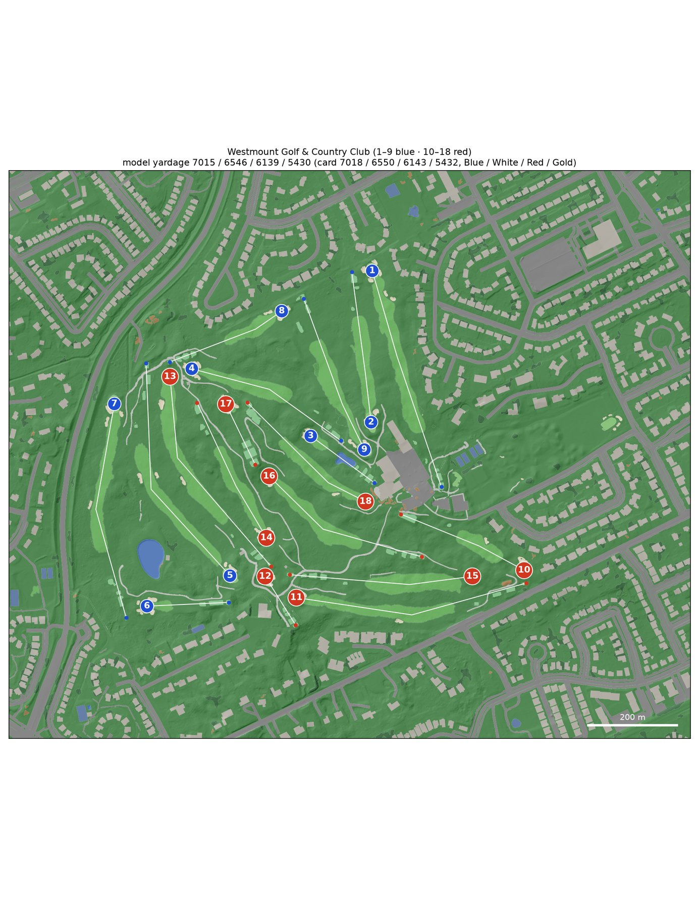

# GSPro course builder

Survey-grade golf courses for the [GSPro](https://gsprogolf.com/) simulator, built end to end from public data:
airborne LiDAR, aerial orthoimagery, OpenStreetMap and the club's scorecard. One engine (`scripts/`) builds every
course. A course is a folder of facts and reviewed corrections (`courses/<slug>/`); what is true of a whole region
(tree species, foliage, turf colour, building palettes, the usual data sources) is a preset in `regions/`.

For each course the build produces:

* a textured glTF you can explore in the bundled three.js viewer;
* an OPCD / GSPro hand-off package: Unity terrain heightmaps, overlays, OPCD SVG, FBX surface meshes named for
  `SetMeshMaterial.cs`, tree prefabs and placements, GreenKeeper data, 3D-grass masks and a Unity editor helper.

The Windows side (Unity 2018.2 + OPCD + GreenKeeper) is the course designer's job: see
[research/GSPRO_COSMETICS.md](research/GSPRO_COSMETICS.md).



## Courses

| Course | Where | Status |
|---|---|---|
| [Westmount Golf & Country Club](courses/westmount/README.md) | Kitchener, Ontario (Stanley Thompson, 1931) | Built and QA'd in two multi-agent rounds. The reference build: its golden fingerprint checks every engine change. |

## How a course is built

1. **Research** (multi-agent, `workflows/course_research.js` with `args: {name, location, slug, root}`): scorecard,
   ratings, tees, hole notes, changes since the LiDAR was flown, and the LiDAR, DEM and imagery sources with their
   dates. An adversarial verifier re-checks every claim.
2. **Scaffold**: `scripts/new_course.py` writes `courses/<slug>/course.toml` with the frame (UTM CRS, or `--crs` for
   a national grid; origin, base height, build and terrain extents), the likely data sources and the region's usual
   leaf state (`[lidar]` / `[imagery]` `leaf_off`, to check against the flight and photo dates), from the OSM course
   outline or a bounding box. `scripts/check_course.py` lists what is still missing.
3. **Downloads** into `data/<slug>/`: LiDAR tiles, the photo, OSM, textures and the 5 km backdrop DEM, through the
   providers in `scripts/sources/` (`nrcan_copc` for NRCan CanElevation, `usgs_3dep` for USGS 3DEP, `arcgis_imageserver`
   for image services such as Ontario's SWOOP or USDA NAIP, `cog_dem` for 1 m DEM files).
4. **Rasters**: the LiDAR is streamed into 0.25 m DEM, DSM, canopy height and intensity rasters. Tiles in another CRS
   than the course frame (State Plane feet, the neighbouring UTM zone, heights in feet) are reprojected as they are
   read; `check_course.py` says which, and flags a datum shift PROJ can only make roughly offline.
5. **Registration**: the photo is shifted onto the LiDAR (`measure_registration.py`: bunker sand against LiDAR
   hollows).
6. **Surfaces**: a random forest on photo colour, near-infrared and LiDAR features, trained on the OSM golf features
   (plus `features/golf.geojson` where OSM is missing or wrong), then vectorised into a gap-free surface partition.
   LiDAR checks keep an unmapped bunker only if it is a closed hollow (it holds water, or has a real face and is not
   open at both ends like a channel; a coarse photo's bunkers are cut to their LiDAR pans) and a tee only if it is a
   flat deck; a fairway several holes run along is split between their corridors (a line that only crosses it takes
   none, unless its green ends close to it). Cart paths OSM lacks can be traced from the photo (`trace_paths.py`).
7. **Trees** from the LiDAR canopy, sorted into the region's archetypes (`detect_trees.py`; leaf-off or leaf-on rules
   per region), each in several shape variants.
8. **Structures**: OSM buildings with LiDAR roof shapes, plus what a course adds by hand (shelters, patios, fountains,
   parked cars).
9. **Mesh**: one conforming triangulation with fine triangles in the playing corridors, bunker lips and water
   objects, joined without seams to the imagery-draped backdrop.
10. **Hole data**: tee markers slid along the real tee decks to the card yardages (never two sets on one spot while
    another pad is free, unless their cards are the same), pins from a green-slope analysis, aim points from the line
    of play.
11. **QA** (multi-agent, `workflows/hole_qa.js` with `args: {root, course, round}`; the course's context is in
    `courses/<slug>/research/qa_brief.md`): per-hole inspectors compare the model with the photo and the LiDAR;
    adversarial verifiers approve or reject every proposed correction, which lands in `courses/<slug>/features/overrides/`.
    Problems that recur across holes are fixed in the engine, with tests.
12. **Export**: glTF, the OPCD package, FBX (headless Blender), yardage-book maps and viewer camera presets.

**[docs/PLAYBOOK.md](docs/PLAYBOOK.md) is the step-by-step guide to building a new course**; [docs/LESSONS.md](docs/LESSONS.md)
explains why the engine works the way it does.

## Repository layout

| Path | What |
|---|---|
| `scripts/` | The engine; `build_all.py` runs its steps in order |
| `scripts/sources/` | Data providers named in `course.toml` [sources] |
| `courses/<slug>/course.toml` | One course's facts: frame, sources, imagery, holes, tees, scorecard, stroke index, ratings, OSM choices, tuning |
| `courses/<slug>/features/` | Hand-made and reviewed features: golf features OSM lacks, structures, QA overrides |
| `courses/<slug>/research/` | OSM snapshot, research notes, hole descriptions, QA verdicts |
| `courses/<slug>/fingerprint.json` | Golden build fingerprint (Westmount) |
| `regions/<name>.toml` | Region presets: tree archetypes and rules, foliage, 3D grass, turf tint, buildings, backdrop, materials, viewer sky, scaffold defaults |
| `data/<slug>/`, `build/<slug>/`, `output/<slug>/` | Downloads, intermediate rasters, products (not tracked) |
| `viewer/` | three.js viewer (`?course=<slug>`) |
| `unity/` | Unity editor helper template for the GSPro package |
| `workflows/` | Multi-agent workflows (Claude Code): course research, per-hole QA rounds, GSPro research |

## Building a course

Requires Python 3.12, [uv](https://github.com/astral-sh/uv) and headless Blender 4.2 LTS (for the FBX step). On
macOS, Blender opens a Metal device even with `-b`: where the GPU is not reachable (a sandboxed shell, for example) it
crashes at startup, and the `fbx` step has to run outside the sandbox.

```bash
uv venv --python 3.12 .venv
uv pip install --python .venv/bin/python -r requirements-lock.txt   # the golden build's exact packages (or requirements.txt)
export COURSE=westmount                                       # the course folder to build
.venv/bin/python scripts/check_course.py                      # what the course still lacks
.venv/bin/python scripts/fetch_data.py lidar osm imagery
.venv/bin/python scripts/fetch_textures.py
.venv/bin/python scripts/fetch_backdrop.py
BLENDER=/path/to/blender .venv/bin/python scripts/build_all.py    # all steps; `build_all.py <from> <to>` runs a range (`--list`: the step names)
.venv/bin/python -m pytest -q tests --ignore=tests/test_course.py   # unit tests (no data or build needed)
.venv/bin/python -m pytest -q --course $COURSE tests/test_course.py   # the built course
python3 scripts/devserver.py 8765   # then open http://localhost:8765/viewer/?course=westmount&v=1#h1-tee
```

`MG_PROFILE=test` builds a small extent around the course's test holes (`[test_profile]`) into `build/<slug>-test/`.
The built-course tests take their limits from `course.toml` `[tests]` (green size range, minimum bunker count,
green slope caps, documented tee gaps `known_tee_gaps = { "7.back" = 40 }`); the defaults are Westmount's.
CI (`.github/workflows/tests.yml`) runs the unit tests: `pytest tests --ignore=tests/test_course.py`.

A new course:

```bash
.venv/bin/python scripts/new_course.py <slug> "Course name" --region <region> --osm way/<id>   # or --bbox=w,s,e,n
COURSE=<slug> .venv/bin/python scripts/check_course.py
```

Then fill in the facts research found (tees, scorecard with `units = "metres"` for a metric card, stroke index,
ratings), check `[lidar]` and `[imagery]` `leaf_off` against the flight and photo dates, fetch, build, register the
photo on the LiDAR, and run the QA rounds:

```bash
COURSE=<slug> .venv/bin/python scripts/build_all.py register mesh     # a first build, up to the mesh
COURSE=<slug> .venv/bin/python scripts/measure_registration.py        # prints the [imagery] shift line for course.toml
COURSE=<slug> .venv/bin/python scripts/build_all.py                   # the build on the registered photo
```

A rerun of `fetch_data.py` or `fetch_textures.py` keeps the files already downloaded. When course.toml no longer
matches them, `fetch_data.py` (or the build, for the LiDAR) stops and names the setting. `docs/PLAYBOOK.md` §3 lists
the keys that allow an expected data gap (open water).

Feature files drawn by hand (`features/`, `research/layout.geojson`) are in the course CRS (`[frame] crs`, metres),
not lon/lat. The regions are `southern_ontario`, `northern_california` and `southern_california` (no palm model
yet: see its header). A course outside them needs a region preset: copy `regions/TEMPLATE.toml.example` to
`regions/<name>.toml` and run the unit tests, which check every region against `scripts/region_spec.py`.

## Rules for engine changes

* **Course and region facts stay out of the code.** They live in `courses/<slug>/course.toml` and `regions/<name>.toml`;
  limits tuned on one course are read with `config.tuning()`. `tests/test_layout.py` fails on a course or region
  named in a string, or a course file reached through the repo root.
* **Westmount must still build to its fingerprint.** `scripts/fingerprint.py check` compares a build with
  `courses/westmount/fingerprint.json`: every downloaded input and product, GeoTIFFs by pixels and georeference,
  `.npz` files by their arrays. Any difference must be explained. Floating-point results only match on the machine
  and package set recorded in the file. FBX and .blend files are listed but not compared, because Blender writes
  timestamps and per-process ids into them.
* **Test first.** Every fix starts with a failing test.

## Data and licences

Each course README lists its sources, their dates and the attribution its products need. Westmount is built from
Ontario and Canada open data (Open Government Licence – Ontario / – Canada) and OpenStreetMap (ODbL). Imagery whose
licence does not allow derived textures to be redistributed (for example Esri World Imagery) is not used.
