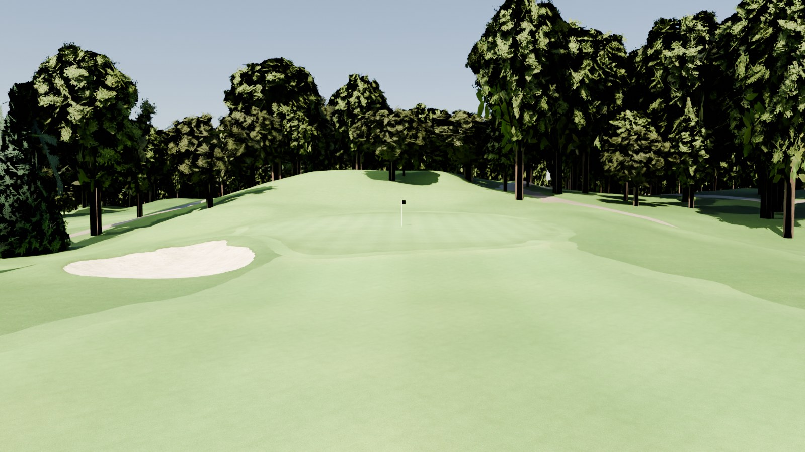
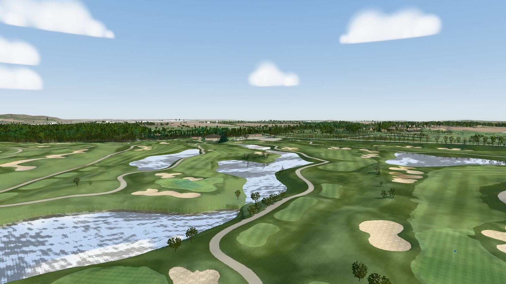
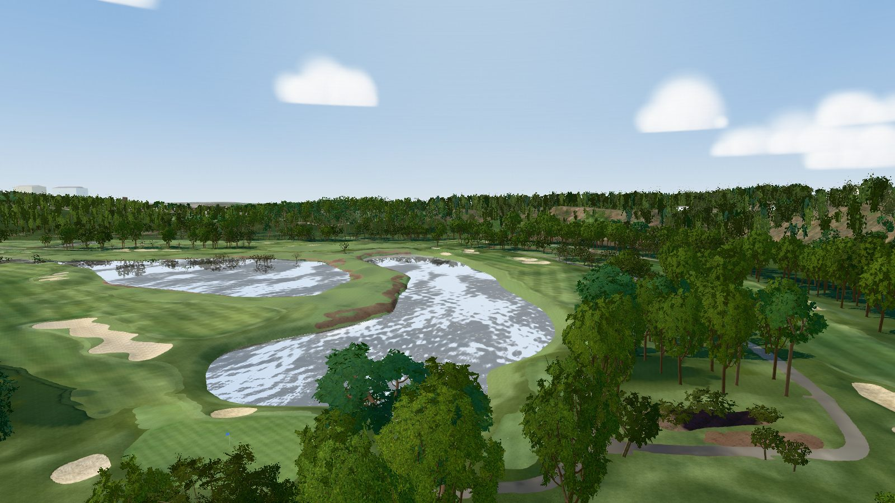

# GSPro course builder

Survey-grade golf courses for the [GSPro](https://gsprogolf.com/) simulator, built end to end from public data:
airborne LiDAR, aerial orthoimagery, OpenStreetMap and the club's scorecard. One engine (`scripts/`) builds every
course. A course is a folder of facts and reviewed corrections (`courses/<slug>/`); what is true of a whole region
(tree species, foliage, turf colour, building palettes, the usual data sources) is a preset in `regions/`.

For each course the build produces:

* a textured glTF you can explore in the bundled three.js viewer;
* an OPCD / GSPro hand-off package: Unity terrain heightmaps, overlays, OPCD SVG, FBX surface meshes named for
  `SetMeshMaterial.cs`, tree prefabs and placements, GreenKeeper data, 3D-grass masks and a Unity editor helper.

The Windows side (Unity 2018.2 + OPCD + GreenKeeper) is the course designer's job: see
[research/GSPRO_COSMETICS.md](research/GSPRO_COSMETICS.md).

## Explore the courses

Four courses are built, and you can walk round any of them in the bundled three.js viewer without hours of downloads
and a build. Each course's viewer bundle (the textured model, the hole data, the camera presets and the yardage-book
maps; 250-280 MB) is an asset of this repository's GitHub Release. One command fetches it, checks it against the
sha256 in `courses/<slug>/prebuilt.json`, unpacks it into `output/<slug>/` and starts the viewer's server. It needs
Python 3.9 or newer and curl (or requests), nothing else.

| | |
|---|---|
| [](courses/westmount/README.md) | [](courses/whistle-bear/README.md) |
| **[Westmount Golf & Country Club](courses/westmount/README.md)**, Kitchener, Ontario | **[Whistle Bear Golf Club](courses/whistle-bear/README.md)**, Cambridge, Ontario |
| [](courses/brambles/README.md) | [](courses/deer-ridge/README.md) |
| **[Brambles](courses/brambles/README.md)**, Middletown, California | **[Deer Ridge Golf Club](courses/deer-ridge/README.md)**, Kitchener, Ontario |

```bash
python3 scripts/get_course.py westmount && python3 scripts/devserver.py 8765      # http://localhost:8765/viewer/?course=westmount#h1-tee
python3 scripts/get_course.py whistle-bear && python3 scripts/devserver.py 8765   # http://localhost:8765/viewer/?course=whistle-bear#h1-tee
python3 scripts/get_course.py brambles && python3 scripts/devserver.py 8765       # http://localhost:8765/viewer/?course=brambles#h1-tee
python3 scripts/get_course.py deer-ridge && python3 scripts/devserver.py 8765     # http://localhost:8765/viewer/?course=deer-ridge#h1-tee
```

Then open the URL. The hole buttons and camera presets are top left; drag to orbit, scroll to zoom. One server shows
every course fetched: change `?course=`. The viewer needs a WebGL browser and loads three.js from cdn.jsdelivr.net.
`get_course.py --list` shows the bundles; `--file` installs one already downloaded. On Windows, type `py` for
`python3`. Each course README has the course map, the card and every hole's yardages. The bundles carry open data
that needs attribution: see [Data and licences](#data-and-licences).

## Courses

| Course | Where | Status |
|---|---|---|
| [Westmount Golf & Country Club](courses/westmount/README.md) | Kitchener, Ontario (Stanley Thompson, 1931) | Built and QA'd in two multi-agent rounds. The reference build: its golden fingerprint checks every engine change. |
| [Whistle Bear Golf Club](courses/whistle-bear/) | Cambridge, Ontario (John Robinson, 2000-01) | Built with its practice facility; QA round 1 (63 override features). Hole 1 and 11 Black tees can't reach the card from any deck (documented gaps). QA round 2 and the course README are still to do. ([#9](https://github.com/mescortes/gspro-course-builder/pull/9)) |
| [Brambles](courses/brambles/) | Middletown, Lake County, California (Coore & Crenshaw with James Duncan, 2024) | The first course without OSM: features drafted from the GolfNow GPS layout and the NAIP photo. QA rounds 1 and 2 (157 override features). Holes 1, 7 and 18 measure short of the card from every deck (documented gaps). The course README is still to do. ([#7](https://github.com/mescortes/gspro-course-builder/pull/7)) |
| [Deer Ridge Golf Club](courses/deer-ridge/) | Kitchener, Ontario (Thomas McBroom; the club dates itself to 1991) | Built on the current engine with six tee sets; the photo is registered to the LiDAR (0.25 m east, 0.25 m south). QA rounds 1 and 2 (51 override features): every hole scores 8 or 9, and test_course passes (137). The course README is still to do. ([#12](https://github.com/mescortes/gspro-course-builder/pull/12)) |

## How a course is built

1. **Research** (multi-agent, `workflows/course_research.js` with `args: {name, location, slug, root}`): scorecard,
   ratings, tees, hole notes, changes since the LiDAR was flown, and the LiDAR, DEM and imagery sources with their
   dates. An adversarial verifier re-checks every claim.
2. **Scaffold**: `scripts/new_course.py` writes `courses/<slug>/course.toml` with the frame (UTM CRS, or `--crs` for
   a national grid; origin, base height, build and terrain extents), the likely data sources and the region's usual
   leaf state (`[lidar]` / `[imagery]` `leaf_off`, to check against the flight and photo dates), from the OSM course
   outline or a bounding box. `scripts/check_course.py` lists what is still missing.
3. **Downloads** into `data/<slug>/`: LiDAR tiles, the photo, OSM, textures and the 5 km backdrop DEM, through the
   providers in `scripts/sources/` (`nrcan_copc` for NRCan CanElevation, `usgs_3dep` for USGS 3DEP, `arcgis_imageserver`
   for image services such as Ontario's SWOOP or USDA NAIP, `cog_dem` for 1 m DEM files).
4. **Rasters**: the LiDAR is streamed into 0.25 m DEM, DSM, canopy height and intensity rasters. Tiles in another CRS
   than the course frame (State Plane feet, the neighbouring UTM zone, heights in feet) are reprojected as they are
   read; `check_course.py` says which, and flags a datum shift PROJ can only make roughly offline.
5. **Registration**: the photo is shifted onto the LiDAR (`measure_registration.py`: bunker sand against LiDAR
   hollows).
6. **Surfaces**: a random forest on photo colour, near-infrared and LiDAR features, trained on the OSM golf features
   (plus `features/golf.geojson` where OSM is missing or wrong), then vectorised into a gap-free surface partition.
   LiDAR checks keep an unmapped bunker only if it is a closed hollow (it holds water, or has a real face and is not
   open at both ends like a channel; a coarse photo's bunkers are cut to their LiDAR pans) and a tee only if it is a
   flat deck; a fairway several holes run along is split between their corridors (a line that only crosses it takes
   none, unless its green ends close to it). Cart paths OSM lacks can be traced from the photo (`trace_paths.py`).
7. **Trees** from the LiDAR canopy, sorted into the region's archetypes (`detect_trees.py`; leaf-off or leaf-on rules
   per region), each in several shape variants.
8. **Structures**: OSM buildings with LiDAR roof shapes, plus what a course adds by hand (shelters, patios, fountains,
   parked cars).
9. **Mesh**: one conforming triangulation with fine triangles in the playing corridors, bunker lips and water
   objects, joined without seams to the imagery-draped backdrop.
10. **Hole data**: tee markers slid along the real tee decks to the card yardages (never two sets on one spot while
    another pad is free, unless their cards are the same), pins from a green-slope analysis, aim points from the line
    of play.
11. **QA** (multi-agent, `workflows/hole_qa.js` with `args: {root, course, round}`; the course's context is in
    `courses/<slug>/research/qa_brief.md`): per-hole inspectors compare the model with the photo and the LiDAR;
    adversarial verifiers approve or reject every proposed correction, which lands in `courses/<slug>/features/overrides/`.
    Problems that recur across holes are fixed in the engine, with tests.
12. **Export**: glTF, the OPCD package, FBX (headless Blender), yardage-book maps and viewer camera presets.

**[docs/PLAYBOOK.md](docs/PLAYBOOK.md) is the step-by-step guide to building a new course**; [docs/LESSONS.md](docs/LESSONS.md)
explains why the engine works the way it does. [CONTRIBUTING.md](CONTRIBUTING.md) covers branches, pull requests and
what each PR reports, for building a course or changing the engine.

## Repository layout

| Path | What |
|---|---|
| `scripts/` | The engine; `build_all.py` runs its steps in order |
| `scripts/sources/` | Data providers named in `course.toml` [sources] |
| `courses/<slug>/course.toml` | One course's facts: frame, sources, imagery, holes, tees, scorecard, stroke index, ratings, OSM choices, tuning |
| `courses/<slug>/features/` | Hand-made and reviewed features: golf features OSM lacks, structures, QA overrides |
| `courses/<slug>/research/` | OSM snapshot, research notes, hole descriptions, QA verdicts |
| `courses/<slug>/README.md`, `images/` | The course, its data, how it was built, what QA left; a map and viewer captures |
| `courses/<slug>/prebuilt.json` | The course's prebuilt viewer bundle: its release asset and sha256 (`scripts/get_course.py`, `scripts/package_course.py`) |
| `courses/<slug>/fingerprint.json` | Golden build fingerprint (Westmount) |
| `courses/<slug>/TODO.md` | A course's open items: hand-off steps, facts to confirm on site (Westmount) |
| `TODO.md` | Engine problems QA rounds found and left open |
| `regions/<name>.toml` | Region presets: tree archetypes and rules, foliage, 3D grass, turf tint, buildings, backdrop, materials, viewer sky, scaffold defaults |
| `data/<slug>/`, `build/<slug>/`, `output/<slug>/` | Downloads, intermediate rasters, products (not tracked) |
| `viewer/` | three.js viewer (`?course=<slug>`) |
| `unity/` | Unity editor helper template for the GSPro package |
| `workflows/` | Multi-agent workflows (Claude Code): course research, per-hole QA rounds, GSPro research |

## Building a course

Requires Python 3.12, [uv](https://github.com/astral-sh/uv) and headless Blender 4.2 LTS (for the FBX step). On
macOS, Blender opens a Metal device even with `-b`: where the GPU is not reachable (a sandboxed shell, for example) it
crashes at startup, and the `fbx` step has to run outside the sandbox.

```bash
uv venv --python 3.12 .venv
uv pip install --python .venv/bin/python -r requirements-lock.txt   # the golden build's exact packages (or requirements.txt)
export COURSE=westmount                                       # the course folder to build
.venv/bin/python scripts/check_course.py                      # what the course still lacks
.venv/bin/python scripts/fetch_data.py lidar osm imagery
.venv/bin/python scripts/fetch_textures.py
.venv/bin/python scripts/fetch_backdrop.py
BLENDER=/path/to/blender .venv/bin/python scripts/build_all.py    # all steps; `build_all.py <from> <to>` runs a range (`--list`: the step names)
.venv/bin/python -m pytest -q tests --ignore=tests/test_course.py   # unit tests (no data or build needed)
.venv/bin/python -m pytest -q --course $COURSE tests/test_course.py   # the built course
python3 scripts/devserver.py 8765   # then open http://localhost:8765/viewer/?course=westmount&v=1#h1-tee
```

`MG_PROFILE=test` builds a small extent around the course's test holes (`[test_profile]`) into `build/<slug>-test/`.
The built-course tests take their limits from `course.toml` `[tests]` (green size range, minimum bunker count,
green slope caps, documented tee gaps `known_tee_gaps = { "7.back" = 40 }`); the defaults are Westmount's.
CI (`.github/workflows/tests.yml`) runs the unit tests: `pytest tests --ignore=tests/test_course.py`.

A new course:

```bash
.venv/bin/python scripts/new_course.py <slug> "Course name" --region <region> --osm way/<id>   # or --bbox=w,s,e,n
COURSE=<slug> .venv/bin/python scripts/check_course.py
```

Then fill in the facts research found (tees, scorecard with `units = "metres"` for a metric card, stroke index,
ratings), check `[lidar]` and `[imagery]` `leaf_off` against the flight and photo dates, fetch, build, register the
photo on the LiDAR, and run the QA rounds:

```bash
COURSE=<slug> .venv/bin/python scripts/build_all.py register mesh     # a first build, up to the mesh
COURSE=<slug> .venv/bin/python scripts/measure_registration.py        # prints the [imagery] shift line for course.toml
COURSE=<slug> .venv/bin/python scripts/build_all.py                   # the build on the registered photo
```

A rerun of `fetch_data.py` or `fetch_textures.py` keeps the files already downloaded. When course.toml no longer
matches them, `fetch_data.py` (or the build, for the LiDAR) stops and names the setting. `docs/PLAYBOOK.md` §3 lists
the keys that allow an expected data gap (open water).

Feature files drawn by hand (`features/`, `research/layout.geojson`) are in the course CRS (`[frame] crs`, metres),
not lon/lat. The regions are `southern_ontario`, `northern_california` and `southern_california` (no palm model
yet: see its header). A course outside them needs a region preset: copy `regions/TEMPLATE.toml.example` to
`regions/<name>.toml` and run the unit tests, which check every region against `scripts/region_spec.py`.

## Rules for engine changes

* **Course and region facts stay out of the code.** They live in `courses/<slug>/course.toml` and `regions/<name>.toml`;
  limits tuned on one course are read with `config.tuning()`. `tests/test_layout.py` fails on a course or region
  named in a string, or a course file reached through the repo root.
* **Westmount must still build to its fingerprint.** `scripts/fingerprint.py check` compares a build with
  `courses/westmount/fingerprint.json`: every downloaded input and product, GeoTIFFs by pixels and georeference,
  `.npz` files by their arrays. Any difference must be explained. Floating-point results only match on the machine
  and package set recorded in the file. FBX and .blend files are listed but not compared, because Blender writes
  timestamps and per-process ids into them.
* **From another machine.** The golden file was written on the owner's Mac, and `fingerprint.py` records that
  environment: machine, OS, Python, GDAL, PROJ, BLAS, Blender and every package. On any other machine the
  floating-point products can differ, and `check` lists the environment differences as `note:` lines. A contributor
  runs:
  * the unit tests;
  * `tests/test_course.py` on their own course;
  * with Westmount's data, a clean Westmount build and `fingerprint.py check`.

  Under each `FAIL:` line, `check` prints the summary entries that changed (surface counts or areas, trees per
  archetype, hole yardages, glTF objects). A `FAIL:` line with nothing under it is floating-point noise. Changed
  summary entries are a real difference, and the PR must explain it. The owner re-runs the Westmount check on the
  golden machine before merging. The commands are in [docs/PLAYBOOK.md §10](docs/PLAYBOOK.md#10-rules).
* **Test first.** Every fix starts with a failing test, on its own branch and PR ([CONTRIBUTING.md](CONTRIBUTING.md)).

## Data and licences

Each course README lists its sources, their dates and the attribution its products need. Imagery whose licence does
not allow derived textures to be redistributed (for example Esri World Imagery) is not used. The prebuilt bundles, and
anything else shipped from this repository, carry:

* Westmount, Whistle Bear and Deer Ridge: *Contains information licensed under the Open Government Licence – Ontario*
  and *the Open Government Licence – Canada* (OMAFRA Lidar 2016-18, SWOOP 2025 orthoimagery, NRCan HRDEM);
* Brambles: USGS 3DEP LiDAR and DEM, and USDA NAIP 2024 orthoimagery, which are public domain;
* every course: course features, buildings and roads from OpenStreetMap, *© OpenStreetMap contributors*, available
  under the Open Database Licence (ODbL); textures from Poly Haven, CC0.

A rebuilt course is packaged again with `scripts/package_course.py <slug>`: it bundles `output/<slug>/`, prints the
size and checksum, and rewrites `courses/<slug>/prebuilt.json` for a new release tag (`--tag`). Publishing the release
is the owner's step; the script prints the `gh release` commands and uploads nothing.
