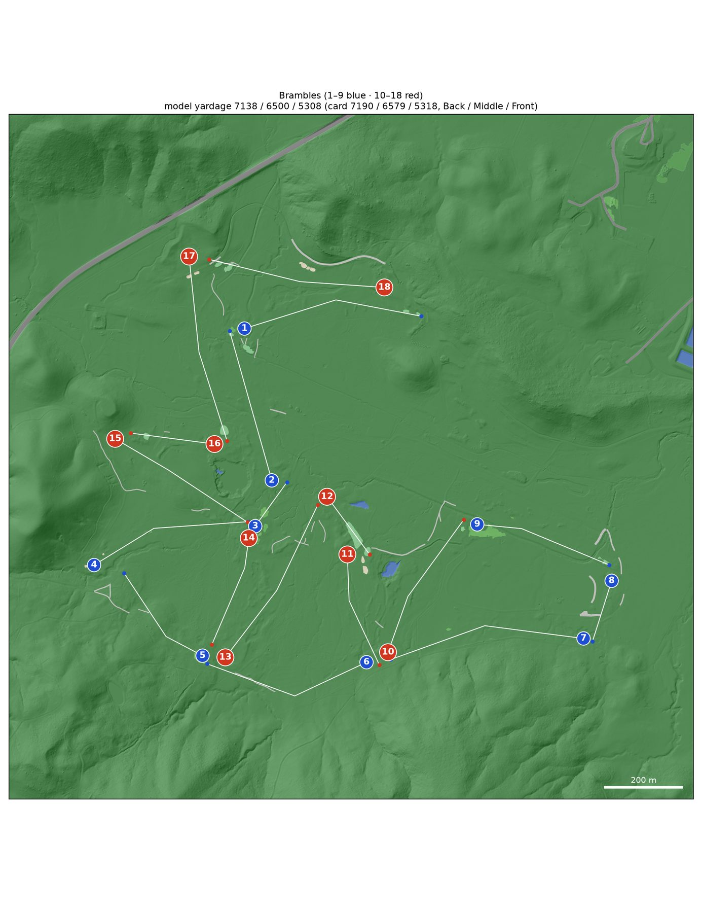
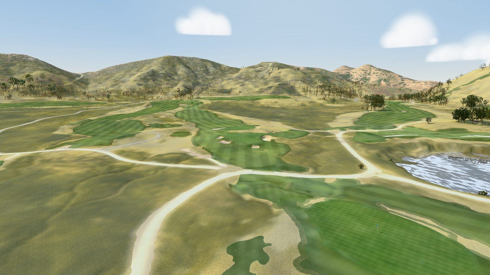
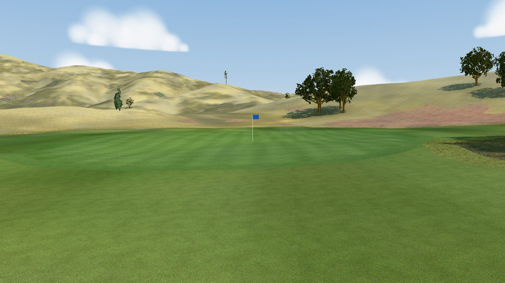

# Brambles

A model of Brambles (Middletown, Lake County, California; Coore & Crenshaw with James Duncan, built 2020-22 on the old
Crazy Creek gliderport, opened April 2024; par 72) for the [GSPro](https://gsprogolf.com/) golf simulator. Zoysia tee
to green, native meadow rough grazed by sheep, barrancas (eroded drainage channels) and one big valley oak in play.
It is the [course builder](../../README.md)'s first course without OpenStreetMap golf features, built from:

* USGS 3DEP LiDAR, flown in September 2023 after the course was shaped and planted;
* USDA NAIP 2024 orthoimagery;
* the GolfNow GPS layout and card (the club publishes neither).

The build produces a textured glTF for the bundled three.js viewer and an OPCD / GSPro hand-off package, as for
[Westmount](../westmount/README.md). The Windows side (Unity 2018.2 + OPCD + GreenKeeper) is the course designer's job.

**Explore it without building** (a 260 MB download; Python 3.9+ and curl):

```bash
python3 scripts/get_course.py brambles && python3 scripts/devserver.py 8765
```

Then open <http://localhost:8765/viewer/?course=brambles#h1-tee>.



| | |
|---|---|
|  |  |
| Hole 3 (par 3) from above the tee: the meadow rough, the gravel paths and the hills round the course | Hole 17: the approach to the green |

*Captures of the bundled viewer (`window.__shot`, [docs/LESSONS.md](../../docs/LESSONS.md#viewer-and-visual-verification)).
GSPro renders with its own materials.*

## The course

| Tee | Yards | Men rating / slope | Women rating / slope |
|---|---|---|---|
| Back | 7,190 | 73.1 / 141 | – |
| Middle | 6,579 | 71.7 / 132 | – |
| Front | 5,318 | – | 71.5 / 127 |

Par 72 (36 out / 36 in). The club publishes no card, no par and, by several accounts, no rating. The only hole-by-hole
card is the GolfPass / 18Birdies feed of GolfNow data (in place by 2026-05-13, unchanged 2026-10-14): par, yards and one
stroke-index row for men and women. All 18 Back yardages match an independent playing report (Golfadelphia,
2026-08-20). The feed's ratings above are unofficial: the USGA rating database could not be checked. The club uses no
tee markers; the tee names are the feed's and the model's colours are ours. See [research/NOTES.md](research/NOTES.md).

Per hole, as modelled. Tee columns give the measured yards (tee → aim points → green centre), with the card yards in
brackets where they differ by more than 6 yd. On holes 1, 7 and 18 no real deck reaches the feed's card (see
[Known limitations](#known-limitations)); every other tee is within 6 yd.

<!-- holes-table -->
| Hole | Par | SI | Back | Middle | Front | Green (yd deep × wide) | Elev. change | Hazards |
|---|---|---|---|---|---|---|---|---|
| 1 | 5 | 7 | 523 (531) | 485 (496) | 410 | 36 × 32 | -7 m | 1 bunker, 1 native_area |
| 2 | 4 | 13 | 445 | 392 | 339 | 43 × 32 | +0 m | 1 native_area |
| 3 | 3 | 15 | 155 | 142 | 100 | 30 × 22 | +4 m | 4 bunker |
| 4 | 4 | 1 | 471 | 440 | 349 | 39 × 32 | +9 m | 3 bunker |
| 5 | 4 | 11 | 335 | 295 | 261 | 36 × 23 | +6 m | 1 bunker |
| 6 | 4 | 5 | 495 | 454 | 300 | 61 × 40 | -9 m | 3 bunker |
| 7 | 5 | 9 | 572 (611) | 516 (572) | 449 | 38 × 24 | -10 m | 1 native_area |
| 8 | 3 | 17 | 182 | 148 | 118 | 38 × 21 | -3 m | 1 bunker, 2 native_area |
| 9 | 4 | 3 | 399 | 374 | 358 | 57 × 15 | +0 m | 1 bunker |
| 10 | 4 | 4 | 441 | 410 | 341 | 44 × 26 | +11 m | 5 bunker |
| 11 | 4 | 12 | 336 | 300 | 264 | 37 × 42 | -10 m | 3 bunker |
| 12 | 3 | 18 | 205 | 163 | 110 | 40 × 32 | -2 m | 1 water |
| 13 | 5 | 2 | 513 | 478 | 360 | 29 × 27 | +14 m | 3 bunker |
| 14 | 4 | 14 | 325 | 279 | 248 | 26 × 31 | -9 m | 5 bunker |
| 15 | 4 | 10 | 448 | 429 | 379 | 27 × 31 | +3 m | 6 bunker, 1 water |
| 16 | 3 | 16 | 242 | 223 | 129 | 50 × 31 | -4 m | 1 bunker |
| 17 | 5 | 6 | 542 | 514 | 468 | 38 × 29 | +5 m | 3 bunker, 1 native_area |
| 18 | 4 | 8 | 510 | 458 (467) | 325 | 68 × 28 | +0 m | 6 bunker, 6 native_area |
| **Total** | **72** | | **7138** (7190) | **6500** (6579) | **5308** (5318) | | | |
<!-- /holes-table -->

## Data

| Input | Source | Licence |
|---|---|---|
| Terrain, trees | USGS 3DEP `CA_NorthCoastRanges_2_B23` (QL1), flown over the course 2023-09-23 and 2023-09-27 (leaf-on), 11-15 ground points per m² on turf | public domain |
| Imagery | USDA NAIP 2024, 0.6 m, R G B + near-infrared, flown 2024-05-22 | public domain |
| Backdrop terrain | 3DEP 1 m DEM of the same survey (no public DSM) | public domain |
| Course features | drafted from the GolfNow GPS tee and green points and the photo, then reviewed (`features/golf.geojson`) | – |
| Roads and buildings round the course | OpenStreetMap (it maps nothing of the course; the gliderport runway, ranch tracks and old landuse are excluded) | ODbL |
| Textures | Poly Haven | CC0 |
| Scorecard | GolfPass / 18Birdies feed (GolfNow data) | facts |

Attribution for anything shipped from this repository: *USGS 3DEP and USDA NAIP (public domain)*; *© OpenStreetMap
contributors*.

## How it was built

The engine's steps are in the [top-level README](../../README.md#how-a-course-is-built). What was particular here:

1. **Research** (2026-10-14, `workflows/course_research.js`): eight researchers and eight verifiers
   ([research/NOTES.md](research/NOTES.md)). The LiDAR was flown seven months before the opening, after every tee and
   green was built, so the model has no synthetic tee decks (`[tuning.level_tees]` off).
2. **Features without OSM.** `scripts/draft_features.py` drafted the holes, greens, tees, fairways, bunkers, water and
   gravel paths from the GolfNow GPS layout (`research/layout.geojson`) and the photo into `features/golf.geojson`
   (`draft=yes`). The random-forest classifier trained on that draft. Holes 1, 4, 6 and 7 are doglegs: their lines
   follow the fairway, not the straight tee-to-green line.
3. **Photo registration**: NAIP 2024 sits 0.75 m east of the LiDAR (`measure_registration.py`, 49 bunkers); the
   halves of the course agree within 0.25 m on its 0.6 m pixels.
4. **A coarse photo.** NDVI does not separate the zoysia from the rough here, so colour and brightness do. Bunkers
   must be closed LiDAR hollows (a barranca, open at both ends, is not) and are cut to their LiDAR pans. The
   near-infrared path tracer is off (`[tuning] trace_paths = false`): it followed turf and barranca edges.
5. **QA, two rounds** (`workflows/hole_qa.js`, brief in [research/qa_brief.md](research/qa_brief.md)): per-hole
   inspectors compared the model with the photo and the LiDAR, and adversarial verifiers approved or rejected each
   correction. Round 1 gave 126 override features, round 2 brought them to 157 (`features/overrides/`, meta on 10
   holes). After round 2 every hole scored 8 or 9 out of 10.
6. **Engine fixes it led to** (in [#6](https://github.com/mescortes/gspro-course-builder/pull/6)): a fairway several
   holes run along is split between their corridors; unmapped and drafted bunkers must be closed hollows; two tee sets
   never share one marker spot.
7. **Rebuilt on the engine fixes from Deer Ridge's QA** (2026-10-17,
   [#15](https://github.com/mescortes/gspro-course-builder/pull/15),
   [#16](https://github.com/mescortes/gspro-course-builder/pull/16)): a tee that sat off the line of play now belongs
   to hole 12, and semirough rings take their fairway's hole (11 rings round shared fairways are split between holes).
   The yardages and the per-hole table are unchanged.
8. **Rebuilt on the engine fixes from Whistle Bear's QA round 2** (2026-10-17,
   [#20](https://github.com/mescortes/gspro-course-builder/pull/20)): the yardage-book maps and the course map above
   draw the fairways, greens, bunkers and water through the rough, and native areas are hazards only inside the course
   outline (holes 8 and 18 each lose one with under 50 m² inside it; four on 17 and 18 are cut to it). The surfaces,
   yardages and pins are unchanged.
9. **Rebuilt on the MountainGate engine fixes** (2026-10-18,
   [#23](https://github.com/mescortes/gspro-course-builder/pull/23)): a drawn bunker leaves no strip of photo sand
   along its lip, so three strips 0.7-1.7 m wide (hole 4's 12.8 m², hole 14's 4.6 and 13.2 m²) are now rough and
   fringe, and holes 4 and 14 list one and two bunker hazards fewer. The yardages are unchanged.

## QA: what was fixed and what is left

Fixed by overrides:

* round 1: tee decks and markers on holes 1, 2, 15 and 18; false bunkers on bare soil and tracks; missing greenside
  bunkers; paths; the hole 4 aim point; the barranca before the 1st green;
* round 2: hole 5's green banks cut (green slope p95 16.5 → 10.5 %); a Back deck on hole 2 (445 against the card's
  450 yd); false bunkers; tree shadows taken for water; dry hillside taken for fairway.

Hole 3's green slope p95 of 14.3 % is the real tier between its south-west lobe and the main body, so `course.toml`
[tests] allows up to 15 % on these bold greens (8, 13 and 10 measure 13.1-13.5 %).

Left for the engine (seen on several holes; the engine-wide list is in [TODO.md](../../TODO.md)):

* dry tan meadow and bare soil classified as fairway or native;
* tree shadows classified as water;
* tee pads that take in the banks round their decks, and markers placed on deck rims;
* bare soil with 0.1 m of relief passing the bunker hollow test;
* the clubhouse road and parking modelled as rough (no override surface exists for roads);
* the 18th green takes in the practice putting green behind it, and two of its pins land there.

## Rebuilding Brambles

Setup and the general commands are in the [top-level README](../../README.md#building-a-course). The downloads are
about 1 GB (LiDAR 590 MB, photo 370 MB, backdrop DEM 12 MB). A clean build on the owner's MacBook Pro (Apple M5 Max,
64 GB; 2026-10-17, engine at d52be39, downloads in place) took about 17 min: rasters 5 min, export and vectorize
3 min each, classify 1.5 min. The largest peaks were rasters 6.8 GB, mesh 6.6 GB, vectorize 6.4 GB and export 5.9 GB.
The mesh has 5.6 M triangles.

```bash
export COURSE=brambles
.venv/bin/python scripts/fetch_data.py lidar osm imagery
.venv/bin/python scripts/fetch_textures.py
.venv/bin/python scripts/fetch_backdrop.py
BLENDER=/path/to/blender .venv/bin/python scripts/build_all.py
.venv/bin/python -m pytest -q --course brambles tests/test_course.py   # 137 passed, 4 skipped (Westmount-only)
python3 scripts/devserver.py 8765   # then open http://localhost:8765/viewer/?course=brambles#h1-tee
```

## Known limitations

* **Card gaps on holes 1, 7 and 18.** From the built tee decks hole 1 measures 523 Back / 485 Middle against the
  feed's 531 / 496, hole 7 572 / 516 against 611 / 572, and hole 18 Middle 458 against 467. The feed's own GPS tee
  and green points give the same shortfall along the line of play, and no source explains it: no deck, aim point or
  routing reaches the card. The markers stay on the real decks; `course.toml` [tests] `known_tee_gaps` records the
  gaps.
* **No official card.** Par, yards, stroke index and ratings are the feed's.
* **0.6 m photo.** Edges are uncertain by about a metre and a small bunker is a few pixels. NAIP 2026 (30 cm, flown
  2026-06-01) should be published around early 2027 and would replace it.
* **Drafted features.** Greens, tees, fairways and bunkers come from the draft and the classifier, corrected in two QA
  rounds; expect some green outlines that take in banks and some partial gravel paths.
* **Windows side not run here.** Unity, OPCD and GreenKeeper do not run on the build host; `grass_3dg.json` values are
  starting estimates.
