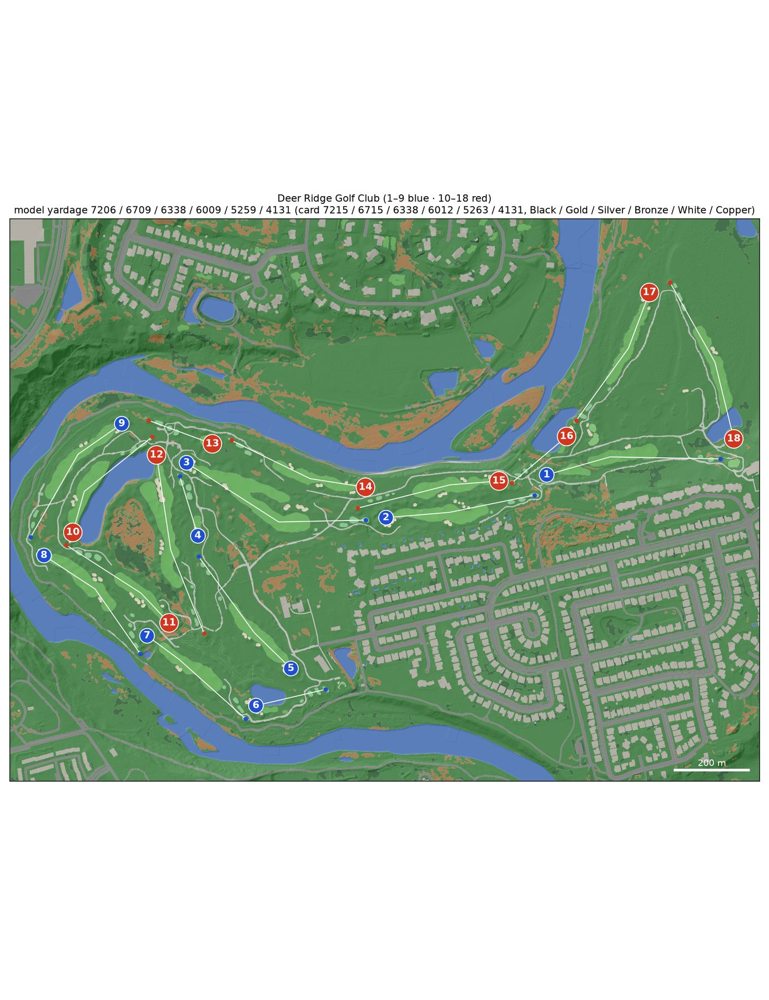
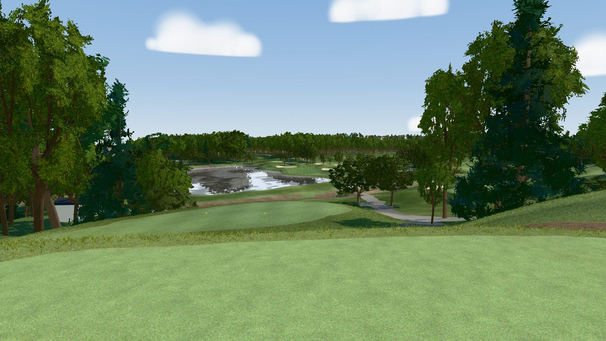

# Deer Ridge Golf Club

A model of [Deer Ridge Golf Club](https://www.deerridgegolfclub.com/) (Kitchener, Ontario; Thomas McBroom, the club
dates itself to 1991; greens complexes rebuilt 2010-11; private, par 72, six tee sets) on the Grand River flood plain,
for the [GSPro](https://gsprogolf.com/) golf simulator. The [course builder](../../README.md) built it end to end from
public data:

* Ontario 2017 LiDAR, flown leaf-off;
* 2025 Ontario orthoimagery;
* OpenStreetMap;
* the club's 2026 scorecard.

The build produces a textured glTF for the bundled three.js viewer and an OPCD / GSPro hand-off package, as for
[Westmount](../westmount/README.md). The Windows side (Unity 2018.2 + OPCD + GreenKeeper) is the course designer's job.

**Explore it without building** (a 280 MB download; Python 3.9+ and curl):

```bash
python3 scripts/get_course.py deer-ridge && python3 scripts/devserver.py 8765
```

Then open <http://localhost:8765/viewer/?course=deer-ridge#h1-tee>.



| | |
|---|---|
|  |  |
| Hole 10 (par 4) from above the tee, with its ponds and bunkers | Hole 16 (par 3) from the Black tee, 12 m above the green |

*Captures of the bundled viewer (`window.__shot`, [docs/LESSONS.md](../../docs/LESSONS.md#viewer-and-visual-verification)).
The turf is graded to summer and the trees are the LiDAR's, sorted into the region's archetypes. GSPro renders with its
own materials.*

## The course

| Tee | Yards | Men rating / slope | Women rating / slope |
|---|---|---|---|
| Black | 7,215 | 75.3 / 133 | – |
| Gold | 6,715 | 72.7 / 131 | – |
| Silver | 6,338 | 70.9 / 128 | 77.4 / 139 |
| Bronze | 6,012 | 69.0 / 126 | 75.4 / 136 |
| White | 5,263 | 65.4 / 114 | 70.9 / 123 |
| Copper | 4,131 | 60.7 / 105 | 64.7 / 108 |

Par 72 (36 out / 36 in). Source: the club's 2026 card (deerridgegolfclub.com, page 1 of the March 2026 PDF) and the
GAO - RCGA ratings on its page 2 (the same as the 2025 ratings card). Copper is new in 2025; on holes 4 and 13 it plays
from the White yardage. The combination sets reuse these six boxes. The stroke index is the 2026 card's: it changed on
the 2024, 2025 and 2026 cards, and OSM's handicap tags match none of them. In GreenKeeper the six sets take the slots
Black, Yellow, Blue, Green, White and Red. See [research/NOTES.md](research/NOTES.md).

Per hole, as modelled. Tee columns give the measured yards (tee → aim points → green centre), with the card yards in
brackets where they differ by more than 6 yd. None does: Black, Gold, Silver and Bronze are within 5 yd on every
hole.

<!-- holes-table -->
| Hole | Par | SI | Black | Gold | Silver | Bronze | White | Copper | Green (yd deep × wide) | Elev. change | Hazards |
|---|---|---|---|---|---|---|---|---|---|---|---|
| 1 | 5 | 5 | 526 | 504 | 495 | 464 | 408 | 323 | 35 × 17 | -5 m | 2 bunker, 9 native_area |
| 2 | 4 | 17 | 449 | 411 | 384 | 373 | 316 | 266 | 34 × 23 | -8 m | 8 bunker, 3 native_area |
| 3 | 5 | 15 | 587 | 553 | 529 | 517 | 444 | 374 | 32 × 18 | -5 m | 6 bunker, 4 native_area |
| 4 | 3 | 13 | 187 | 169 | 152 | 142 | 122 | 122 | 28 × 24 | -1 m | 2 bunker |
| 5 | 4 | 9 | 435 | 410 | 384 | 376 | 297 | 245 | 40 × 16 | +0 m | 5 bunker |
| 6 | 3 | 3 | 214 | 189 | 167 | 137 | 118 | 75 | 20 × 32 | -2 m | 3 bunker, 1 water |
| 7 | 4 | 7 | 385 | 363 | 349 | 329 | 280 | 223 | 23 × 19 | +0 m | 1 bunker, 1 lateral_water, 2 native_area, 1 water |
| 8 | 4 | 11 | 418 | 399 | 367 | 339 | 329 | 244 | 44 × 17 | +0 m | 5 bunker, 1 lateral_water, 2 native_area, 2 water |
| 9 | 4 | 1 | 445 | 414 | 402 | 376 | 318 | 271 | 30 × 21 | +1 m | 4 bunker, 5 native_area |
| 10 | 4 | 6 | 387 | 361 | 353 | 327 | 291 | 206 | 50 × 20 | -1 m | 6 bunker, 2 native_area, 1 water |
| 11 | 4 | 18 | 388 | 343 | 321 | 311 | 289 | 205 | 37 × 17 | -2 m | 7 bunker, 1 lateral_water, 4 native_area, 1 water |
| 12 | 5 | 14 | 555 | 524 | 507 | 485 | 417 | 342 | 30 × 27 | +1 m | 5 bunker, 1 lateral_water, 1 native_area, 1 water |
| 13 | 3 | 16 | 202 | 179 | 165 | 138 | 114 | 114 | 30 × 22 | -2 m | 1 native_area |
| 14 | 4 | 2 | 429 | 398 | 372 | 361 | 323 | 209 | 37 × 18 | +4 m | 4 bunker, 2 native_area, 1 water |
| 15 | 4 | 12 | 431 | 389 | 361 | 336 | 318 | 230 | 30 × 16 | +7 m | 4 bunker |
| 16 | 3 | 10 | 214 | 184 | 164 | 157 | 138 | 95 | 39 × 18 | -12 m | 2 bunker, 4 native_area, 1 water |
| 17 | 4 | 4 | 444 | 421 | 396 | 381 | 312 | 246 | 34 × 18 | +1 m | 3 bunker, 1 native_area, 1 water |
| 18 | 5 | 8 | 510 | 498 | 470 | 460 | 425 | 341 | 19 × 21 | +1 m | 2 bunker, 1 native_area, 1 water |
| **Total** | **72** | | **7206** (7215) | **6709** (6715) | **6338** (6338) | **6009** (6012) | **5259** (5263) | **4131** (4131) | | | |
<!-- /holes-table -->

## Data

| Input | Source | Licence |
|---|---|---|
| Terrain, trees | OMAFRA Lidar 2016-18 (Lake Erie package), NRCan CanElevation COPC tiles from the Lake_Erie_Fall_2017 and Lake_Erie_2018 folders; inside the course every point was flown 2017-11-21 (leaf-off) | Open Government Licence – Ontario / – Canada |
| Imagery | SWOOP 2025 (Geospatial Ontario), 16 cm, R G B + near-infrared, flown 2025-04-07, three days after a Grand River flood peak | Open Government Licence – Ontario |
| Backdrop terrain, trees | NRCan HRDEM 1 m DTM and DSM (half Lake_Erie_2018, half Lake_Erie_Fall_2017) | Open Government Licence – Canada |
| Course features | OpenStreetMap: the outline (way 140907484), 18 holes, 21 greens, 74 tees, 78 bunkers, 25 fairways, 39 paths | ODbL |
| Textures | Poly Haven | CC0 |
| Scorecard, ratings | the club's 2026 card; GAO - RCGA ratings | facts |

Attribution for anything shipped from this repository: *Contains information licensed under the Open Government
Licence – Ontario* and *– Canada*; *© OpenStreetMap contributors*.

## How it was built

The engine's steps are in the [top-level README](../../README.md#how-a-course-is-built). What was particular here:

1. **Research** (2026-10-14, `workflows/course_research.js`): the card and ratings, the 2010 greens rebuild, the June
   2017 flood (repaired before the LiDAR flight), the forward tees built since the LiDAR, and the data sources
   ([research/NOTES.md](research/NOTES.md)).
2. **Frame.** The OSM outline is 2,121 m wide; its east end is a subdivision, a wetland and a parking lot with no golf
   feature. The build area covers the golf features, so it fits GSPro's 2,048 m terrain square (`course.toml` [frame]).
3. **Photo registration**: SWOOP 2025 sits 0.25 m west and 0.25 m north of the LiDAR (`measure_registration.py`, 70
   bunkers), so the photo is shifted 0.25 m east and 0.25 m south.
4. **A flood photo.** The April 2025 photo shows a wet corridor and a flooded backwater along the south bank as dark
   brown or open water; on the ground they are turf or rough. The QA brief tells the inspectors so, and the QA rounds
   fixed the surfaces the classifier took for native.
5. **Engine fixes it needed** (in [#11](https://github.com/mescortes/gspro-course-builder/pull/11)): hole 1's green
   and four tees are tagged `leisure=pitch` + `sport=golf` in OSM and stay golf (they used to become courts), and the
   18 ha of lawns round the course the classifier called green (Homer Watson Park, for one) are rough: classifier
   greens more than 15 m off the course outline are dropped.
6. **Tees built since the LiDAR.** The 2020 and 2021 forward decks that OSM maps are levelled as synthetic decks
   (`[tuning] level_tees`). The Copper set has no pads of its own: its markers are pinned on mown fairway at the card
   distance on holes 2, 3, 6, 9, 10, 12 and 16. Elsewhere the engine places them at the card distance on the best ground
   near the back tee's first leg (fairway first, clear of bunkers, water and native areas).
7. **QA, two rounds** (`workflows/hole_qa.js`, brief in [research/qa_brief.md](research/qa_brief.md)): round 1 approved
   46 corrections and rejected 3; round 2 approved 17, rejected none and found no round-1 override harmful. That is 51
   override features and 8 meta files (`features/overrides/`). Every hole now scores 8 or 9 out of 10.
8. **Engine fixes from its QA** ([#15](https://github.com/mescortes/gspro-course-builder/pull/15),
   [#16](https://github.com/mescortes/gspro-course-builder/pull/16)), and the model rebuilt on them (2026-10-17):
   * OSM forward tees off the `golf=hole` line go to the hole whose card they play (1, 3, 8 and 13 here, which QA had
     fixed by overrides);
   * semirough rings take the hole of the fairway they ring;
   * deckless forward markers (Copper) look at the ground (see step 6);
   * the Grand River is water: the OSM snapshot now has all 47 members of its relation, and the river falls in
     reaches, each with its own flat water plane;
   * the reedbed is a lateral penalty area on its own ground (native, deep rough, rough), not a pond below the reeds:
     one `lateral_water` hazard on holes 7, 8, 11 and 12;
   * the cycle trails (Walter Bean Grand River Trail, Trans-Canada Trail) are paths;
   * the small mapped fairways (collection areas and drop zones of 66-238 m², by the greens of 6, 14, 16 and 18) are
     fairway;
   * classifier greens lying mostly under the closed canopy are rough.
9. **Engine fixes from Whistle Bear's QA round 2** ([#20](https://github.com/mescortes/gspro-course-builder/pull/20)),
   and the model rebuilt on them (2026-10-17):
   * the Grand River is cut at the 1.4 m weir on the north edge of the build (N 4806807-4806816) instead of about
     40 m above it, where 3,595 m² of water sat 0.7-1.6 m below the LiDAR; its other reaches are unchanged;
   * the yardage-book maps and the course map above draw the fairways, greens, bunkers and water through the rough;
   * native areas outside the course outline are no longer hazards (four on holes 2, 8 and 14), and those crossing
     it are cut to it (holes 2, 8, 9 and 13). Water off the outline, the Grand River beside 8 and 14, stays a hazard.

   The surfaces, yardages and pins are unchanged.

## QA: what was fixed and what is left

Fixed by overrides:

* OSM forward tees the engine had left in the background because they sit off the `golf=hole` line, given to their
  holes (1, 3, 8, 13);
* the 2020 forward deck on 9, the enlarged 2021 deck on 5, and under-mapped decks on 10 (Black) and 12 (White);
* the flood corridor's wet turf and the south-bank backwater no longer native (holes 5, 7, 12);
* false cart paths traced along deck rims, tree rows and shadows removed (14, 15, 17), and the OSM paths across the
  reedbed restored where the carved water cut them (11, 12);
* false greens in 15's approach and on the Grand River, and a false sand tail on 10, removed;
* hole 4's green tongue trimmed to the LiDAR crest, its approach under the spruce shadow and its collection area mown;
  green tails trimmed on 12 and 16;
* bunkers given their holes (8, 15), and a practice bunker by the maintenance yard;
* hole 1's and hole 3's aim points (hole 3 Black now 587, as on the card);
* Copper markers pinned on mown fairway on 2, 3, 6, 9, 10, 12 and 16.

Left for QA overrides (no engine rule can tell them apart safely; the engine-wide list is in
[TODO.md](../../TODO.md)):

* classifier greens that grow fingers along mown approach strips (QA trimmed them on 4, 12 and 16);
* dense conifer shadows that take the fairway class off mown turf;
* an 87 m² background green on the practice turf by the maintenance yard's practice bunker (E 546618 N 4805674), new
  since the classifier retrained on the river and reedbed labels.

## Rebuilding Deer Ridge

Setup and the general commands are in the [top-level README](../../README.md#building-a-course). The downloads are
about 2 GB (LiDAR 980 MB, photo 1.0 GB, backdrop DEM 26 MB). A clean build on the owner's MacBook Pro (Apple M5 Max,
64 GB; 2026-10-17, engine at f0c2546, downloads in place) took about 25 min: vectorize 7.5 min, rasters 4.5 min,
export 3.5 min. The largest peaks were mesh 8.3 GB, vectorize 7.5 GB and rasters 5.7 GB. The mesh has 4.7 M triangles.

```bash
export COURSE=deer-ridge
.venv/bin/python scripts/fetch_data.py lidar osm imagery
.venv/bin/python scripts/fetch_textures.py
.venv/bin/python scripts/fetch_backdrop.py
BLENDER=/path/to/blender .venv/bin/python scripts/build_all.py
.venv/bin/python -m pytest -q --course deer-ridge tests/test_course.py   # 137 passed, 4 skipped (Westmount-only)
python3 scripts/devserver.py 8765   # then open http://localhost:8765/viewer/?course=deer-ridge#h1-tee
```

The 5 km backdrop photo comes from the LIO image server, which can stop with HTTP 500 / 502 responses: rerun
`fetch_backdrop.py` (or the build) and it resumes.

## Known limitations

* **2017 terrain, newer forward tees.** The forward decks built in 2020 and 2021 are synthetic level decks where OSM
  maps them; their real heights are unknown.
* **Copper and White.** Copper has no pads of its own (see above). White on hole 6 is an automatic fairway marker 15 yd
  ahead of the Bronze deck: neither the photo nor the LiDAR shows a forward deck there.
* **The Grand River** is water in reaches: each reach is a flat plane 0.05-0.3 m below its banks' low shoreline, so
  the river steps down rather than sloping.
* **Leaf-off sources.** Tree species groups are inferred from crown shape and pulse penetration, not surveyed; crown
  sizes come from a closed leaf-off canopy.
* **Spring flood photo.** The wet ground was corrected in QA; turf colour in the glTF and viewer is graded to summer.
  GSPro assigns its own turf materials by object name.
* **Windows side not run here.** Unity, OPCD and GreenKeeper do not run on the build host; `grass_3dg.json` values are
  starting estimates.
