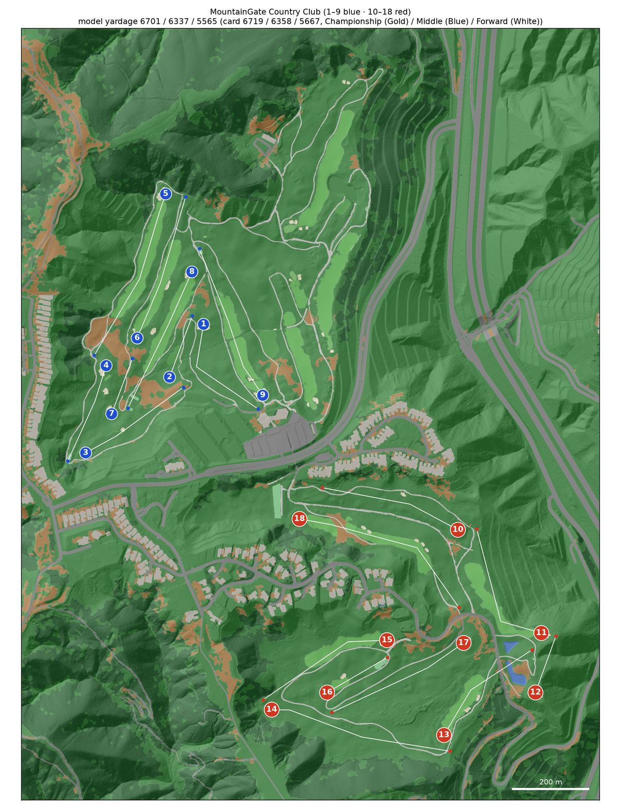
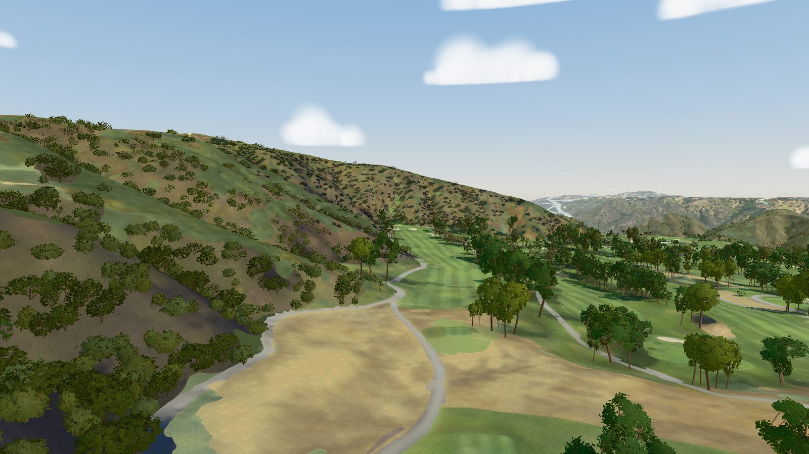
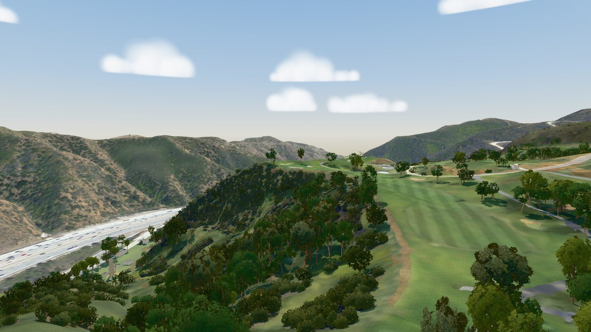

# MountainGate Country Club: North/South

A model of the North/South course at MountainGate Country Club (Los Angeles, California; Ted Robinson, opened 1975-76; par 72)
for the [GSPro](https://gsprogolf.com/) golf simulator. The North nine (holes 1-9) and the South nine (10-18) are
played; the Lake nine is modelled as scenery (holes 19-27), with the canyons of the Santa Monica Mountains around it.
It is the [course builder](../../README.md)'s first Southern California course, built from:

* USGS 3DEP LiDAR, flown in January 2025;
* USDA NAIP 2024 orthoimagery;
* OpenStreetMap;
* the club's North/South card.

The build produces a textured glTF for the bundled three.js viewer and an OPCD / GSPro hand-off package, as for
[Westmount](../westmount/README.md). The Windows side (Unity 2018.2 + OPCD + GreenKeeper) is the course designer's
job: see [research/GSPRO_COSMETICS.md](../../research/GSPRO_COSMETICS.md).



| | |
|---|---|
|  |  |
| Hole 5 (par 5) from above the tees: the turf converted to native planting, the fairway running into the canyon under the chaparral | Hole 11 (stroke index 1): the fairway bends round the wooded canyon above the I-405 in the Sepulveda Pass |

*Captures of the bundled viewer (`window.__shot`, [docs/LESSONS.md](../../docs/LESSONS.md#viewer-and-visual-verification)).
GSPro renders with its own materials.*

## The course

| Tee | Yards | Men rating / slope | Women rating / slope |
|---|---|---|---|
| Championship (Gold) | 6,719 | 73.2 / 134 | 80.4 / 143 |
| Middle (Blue) | 6,358 | 71.6 / 132 | 78.3 / 139 |
| Forward (White) | 5,667 | 68.3 / 123 | 74.7 / 129 |

Par 72 (36 out / 36 in; the women's par is 73). Source: the North/South card (golfingrecord.com, cross-checked against
offcourse.co and the greenskeeper.org per-nine cards, 2026-10-10). Older 6,766-yard cards are out of date. The sources
disagree on the women's stroke index, so the model gives everyone the men's. GreenKeeper has no Gold tee slot: Gold
goes in Black. See [research/NOTES.md](research/NOTES.md).

Per hole, as modelled. Tee columns give the measured yards (tee → aim points → green centre), with the card yards in
brackets where they differ by more than 6 yd. On holes 5, 10, 17 and 18 no real deck reaches the card (see
[Known limitations](#known-limitations)); every other tee is within 6 yd.

<!-- holes-table -->
| Hole | Par | SI | Championship (Gold) | Middle (Blue) | Forward (White) | Green (yd deep × wide) | Elev. change | Hazards |
|---|---|---|---|---|---|---|---|---|
| 1 | 4 | 16 | 342 | 323 | 307 | 21 × 15 | -12 m | 2 bunker, 3 native_area |
| 2 | 3 | 10 | 189 | 169 | 153 | 13 × 28 | +3 m | 1 bunker, 4 native_area |
| 3 | 4 | 6 | 342 | 323 | 298 | 37 × 16 | +17 m | 4 bunker, 2 native_area |
| 4 | 4 | 18 | 299 | 289 | 266 | 29 × 12 | -10 m | 3 bunker, 1 native_area |
| 5 | 5 | 8 | 516 | 498 | 423 (467) | 21 × 27 | -5 m | 4 bunker, 5 native_area |
| 6 | 4 | 2 | 434 | 408 | 363 | 22 × 25 | -4 m | 4 bunker, 2 native_area |
| 7 | 3 | 14 | 172 | 153 | 131 | 28 × 16 | +0 m | 4 bunker, 7 native_area |
| 8 | 4 | 4 | 437 | 420 | 401 | 29 × 24 | -9 m | 3 bunker, 10 native_area |
| 9 | 5 | 12 | 466 | 453 | 403 | 24 × 14 | +9 m | 4 bunker, 5 native_area |
| 10 | 4 | 15 | 417 | 390 | 358 (366) | 33 × 23 | -35 m | 5 bunker, 3 native_area |
| 11 | 4 | 1 | 400 | 387 | 364 | 26 × 19 | +1 m | 4 bunker, 6 native_area, 1 water |
| 12 | 3 | 13 | 174 | 153 | 97 | 27 × 21 | -3 m | 3 bunker, 4 native_area, 1 water |
| 13 | 4 | 9 | 365 | 356 | 219 | 20 × 35 | +2 m | 5 bunker, 14 native_area, 2 water |
| 14 | 5 | 5 | 535 | 513 | 460 | 22 × 16 | +28 m | 6 bunker, 4 native_area |
| 15 | 4 | 11 | 412 | 361 | 326 | 20 × 27 | -13 m | 2 bunker, 2 native_area |
| 16 | 3 | 17 | 203 | 190 | 180 | 23 × 19 | +0 m | 3 bunker, 2 native_area |
| 17 | 4 | 7 | 434 (450) | 416 (430) | 369 (382) | 29 × 16 | -13 m | 5 bunker, 1 native_area |
| 18 | 5 | 3 | 563 | 535 | 447 (481) | 28 × 18 | +23 m | 7 bunker, 9 native_area |
| **Total** | **72** | | **6701** (6719) | **6337** (6358) | **5565** (5667) | | | |
<!-- /holes-table -->

## Data

| Input | Source | Licence |
|---|---|---|
| Terrain, trees | USGS 3DEP `CA_2025LosAngelesPostWildfire_C25`, flown 2025-01-21 (leaf-on), about 45 points per m² (classes 1 / 2 / 7 / 17 / 18) | public domain |
| Imagery | USDA NAIP 2024, 0.6 m, R G B + near-infrared, flown 2024-05-06 | public domain |
| Backdrop terrain | 3DEP 1 m DEM of the same survey, gaps from LA County's 2023 survey (`CA_LosAngeles_B23`); no public DSM | public domain |
| Course features, roads, buildings | OpenStreetMap (all 27 holes, greens, tees, fairways, bunkers, ponds, cart paths), corrected by the QA overrides | ODbL |
| Textures | Poly Haven | CC0 |
| Scorecard | the club's North/South card via golfingrecord.com, offcourse.co, greenskeeper.org | facts |

Attribution for anything shipped from this repository: *USGS 3DEP and USDA NAIP (public domain)*; *© OpenStreetMap
contributors*.

## How it was built

The engine's steps are in the [top-level README](../../README.md#how-a-course-is-built). What was particular here:

1. **A port.** MountainGate was first built as a standalone project, the one this course builder grew out of; its
   GSPro package was delivered on 2026-10-11. This folder carries its course facts, its research (2026-10-10) and its
   QA corrections over to this engine. Its own engine extras (a GreenKeeper `.GKD` writer, locked day pins, props,
   ground colliders, tree tiers, planting masks) are not part of this engine and are not built here; its OB and
   penalty areas are kept as reference in [research/](research/) (`ob.geojson`, `penalty_areas.geojson`).
2. **OSM** maps all 27 holes. Its golf=hole refs number the nines North 1-9, Lake 10-18, South 19-27; course.toml
   `[holes.osm_ref]` maps them onto the card, and the Lake nine is scenery. OSM maps the cart paths, so the photo path
   tracer is off (`[tuning] trace_paths = false`).
3. **The photo.** NAIP 2024 shows most of the bunker renovation and the turf converted to native planting
   between the holes; NAIP 2022 (the newest photo on USGS The National Map) shows neither. It sits 0.75 m east and
   0.25 m south of the LiDAR (`measure_registration.py`, 84 bunkers): `[imagery] shift = [-0.75, 0.25]`.
4. **Native ground.** The native seed colours are set for this photo (`[tuning.native]`): the tan sand-and-mulch
   plantings are brighter than the engine's default allows. Their texture is `gravelly_sand` (`[materials] native`):
   the region's `withered_grass` repeats visibly over areas this large.
5. **Colours, trees, grass and buildings** tuned in the first port's visual review (on NAIP 2022) are course.toml tables over
   the region's (`[turf_tint]`, `[trees.*]`, `[foliage.*]`, `[grass.*]`, `[buildings]`, `[materials]`, `[viewer]`).
6. **No synthetic tee decks** (`[tuning.level_tees]` off): the LiDAR was flown after every tee was built.
7. **QA, four rounds** (`features/overrides/`, 268 override features; tee markers locked on 9 holes, aim points on 2):
   * rounds 1 and 2 ran in the standalone project on another photo (Esri World Imagery, newer than May 2024): 144
     features; after round 2 every hole scored 8 or 9 ([research/qa/](research/qa/));
   * a round on the 2025 LiDAR (hillshade and depths, all 27 holes) redrew bunkers, greens and tees to the renovated
     ground: 113 corrections;
   * round 3 on this engine and the NAIP 2024 photo (`workflows/hole_qa.js`, brief in
     [research/qa_brief.md](research/qa_brief.md)): 16 changes approved, 11 rejected, 5 earlier overrides corrected
     or removed. Every hole scores 8 or 9, except hole 18 (7: the photo predates its second-leg bunkers and path).

## QA: what was fixed and what is left

Fixed by overrides:

* the renovation: bunkers reshaped, moved, filled and added, green edges rebuilt, to the 2025 LiDAR;
* tee pads: false pads on banks and lawns removed, OSM tees on hole 5 that are now native planting, the hole 13 and 17
  decks, markers on the real decks (tee locks on 9 holes);
* fairway, path and rough corrections from rounds 1 and 2; the dogleg aim points on holes 1 and 15.

Left for the engine (seen on several holes):

* OSM cart paths outside the club's leisure=golf_course outline become road (the 593 m² path behind the hole 1 tees);
  the outline is narrower than the club's land;
* thin automatic bunker slivers left along the lips of drawn bunkers, each a tiny hazard in holes.json;
* automatic tee pads taken from OSM tees without a LiDAR deck check (hole 5's converted pads);
* canyon woodland and chaparral split between rough and deep rough (rough with a 2.5 m canopy on holes 10-12);
* aim points kept on bends of 2-4 degrees;
* surfaces take their colour from the photo, so the bunkers built after May 2024 (hole 16's approach and front-left
  bunkers, hole 18's five second-leg and corner bunkers) render olive, where the photo still shows turf; deep tree
  shadow in the photo comes out as dark blue-grey blotches on the canyon walls (holes 13, 14, 16, 18) and makes the
  shaded path left of the hole 4 tees read as water;
* GreenKeeper's OB ring (`pOOB`) is empty: the course's OSM outline is two rings (a multipolygon), and the engine takes
  the ring from a single-polygon outline only. `test_greenkeeper_gkd_hints` fails on it.

## Known limitations

* **Tees against the card.** Where no real deck delivers the card yardage the marker stays on the deck (yards,
  measured / card): hole 5 Forward 423 / 467 (its old pad is native planting now; the only forward deck left), hole 10
  Forward 358 / 366, hole 17 all three sets 13-16 yd short (434 / 450, 416 / 430, 369 / 382, on the three built
  decks), hole 18 Forward 447 / 481 (the only forward pad; the card's Forward set is a composite). course.toml
  `[tests] known_tee_gaps` records them.
* **Photo older than part of the ground.** The May 2024 photo predates the last of the renovation on the South nine
  (hole 18's second-leg and corner bunkers and path, the filled hole 15 / 16 pans, hole 15's south-west greenside
  bunker, the new path from the hole 16 junction to the hole 15 green). The model follows the 2025 LiDAR there, but the
  photo texture still shows the old ground. Holes 16 and 18 score 6 of 10 in the viewer review for it
  (every other hole 7-9).
* **OB and penalty areas** are not modelled (see the QA list for the empty `pOOB`); the original build's are in
  [research/](research/) for the GreenKeeper work.
* **Buildings.** OSM footprints with LiDAR-fitted roofs. Where a building stands on a slope, its wall runs down to the
  ground below it (the condominiums above hole 10), and the clubhouse shows its LiDAR roof as a faceted sheet above the parapet. The backdrop has no trees or buildings (no public DSM).
* **Trees** are inferred from LiDAR structure and the photo's crown colour (coast live oak, Aleppo pine, sycamore,
  eucalyptus, shrub; the region has no palm model). The prefabs are `Tree_<archetype>_v0` to `_v4` for the five archetypes (the delivered package had `Tree_oak_*` and `Tree_pine_*`).
* **The Windows side was not run here.** Unity, OPCD and GreenKeeper do not run on macOS. The Unity helper is
  syntax-checked (tree-sitter), not compiled; `grass_3dg.json` values are starting estimates. The FBX files are written
  with Blender 4.2.23 LTS. `tree_prefabs.fbx` embeds each material's textures; in Unity, extract them (the model's
  Materials tab), set the `Foliage_*` materials to Cutout with the glTF's alpha cutoff, 0.45, and mark the `*_normal`
  textures as normal maps: the Unity helper does not do this yet.
* **Private club.** MountainGate is a private club and its name may be a trademark: keep the built course private
  unless the club agrees otherwise.

## Rebuilding MountainGate

Setup and the general commands are in the [top-level README](../../README.md#building-a-course). The downloads are
about 1.5 GB (LiDAR 1.05 GB in 9 tiles, Poly Haven textures 212 MB, backdrop photos 172 MB, course photo 31 MB, backdrop
DEM 14 MB). Measured on a
MacBook Pro (Apple M2 Max, 12 cores, 32 GB, macOS 27.0.1; 2026-10-17, Blender 4.2.23 LTS), downloads in place: about
55 minutes from the step times, most of it vectorize (28 min) and rasters (11 min); the first backdrop run also downloads
its photos (6 min here). Peak memory 7.3 GB (rasters and vectorize); mesh 5.9 GB, export 5.1 GB, gspro 3.8 GB.

```bash
export COURSE=mountaingate
.venv/bin/python scripts/fetch_data.py lidar osm imagery
.venv/bin/python scripts/fetch_textures.py
.venv/bin/python scripts/fetch_backdrop.py
BLENDER=/path/to/blender-4.2 .venv/bin/python scripts/build_all.py   # Blender 4.2 LTS (macOS default: /Applications/Blender.app)
.venv/bin/python -m pytest -q --course mountaingate tests/test_course.py   # 138 passed, 1 failed (pOOB), 4 skipped (Westmount-only)
python3 scripts/devserver.py 8765   # then open http://localhost:8765/viewer/?course=mountaingate#h1-tee
```
