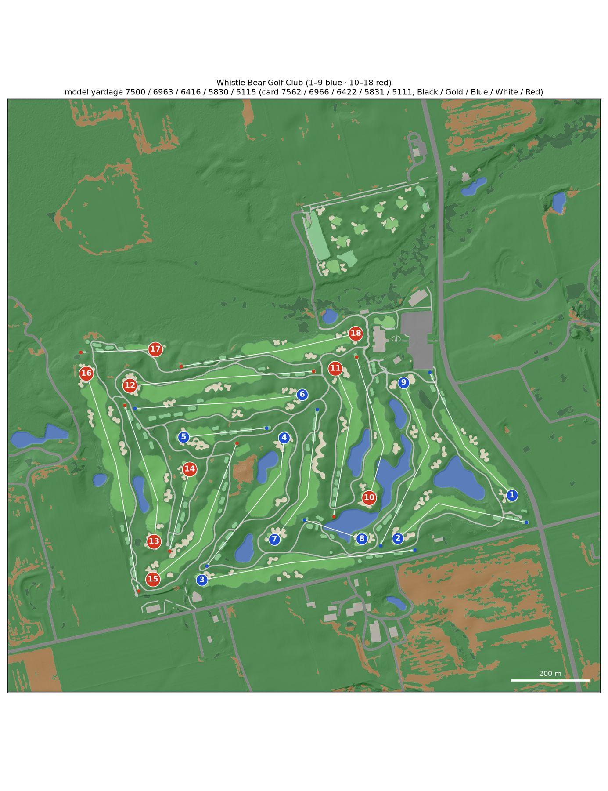
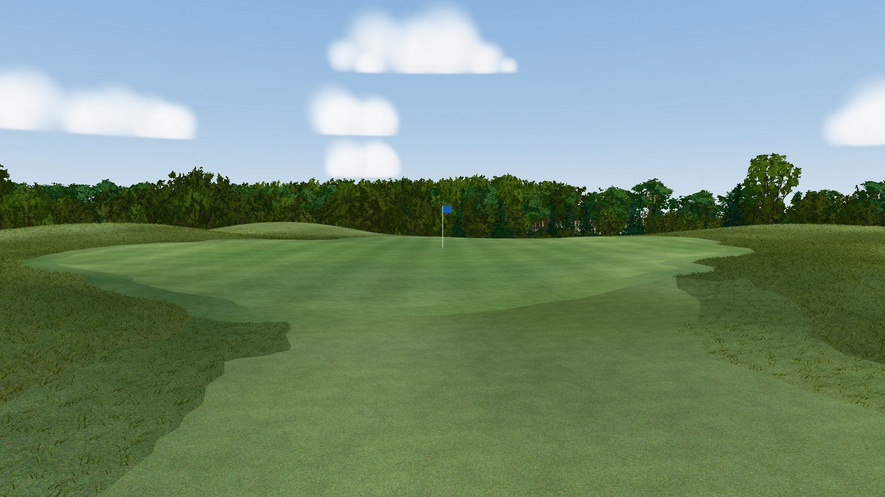

# Whistle Bear Golf Club

A model of [Whistle Bear Golf Club](https://www.whistlebear.ca/) (Cambridge, Ontario; John Robinson, opened 2000-01;
par 72) for the [GSPro](https://gsprogolf.com/) golf simulator, with its practice facility (the Golf Academy: driving
range, target greens and short-game area). The [course builder](../../README.md) built it end to end from public data:

* Ontario 2017 LiDAR, flown leaf-off;
* 2025 Ontario orthoimagery;
* OpenStreetMap;
* the club's 2021 scorecard.

The build produces a textured glTF for the bundled three.js viewer and an OPCD / GSPro hand-off package, as for
[Westmount](../westmount/README.md). The Windows side (Unity 2018.2 + OPCD + GreenKeeper) is the course designer's job.

**Explore it without building** (a 250 MB download; Python 3.9+ and curl):

```bash
python3 scripts/get_course.py whistle-bear && python3 scripts/devserver.py 8765
```

Then open <http://localhost:8765/viewer/?course=whistle-bear#h1-tee>.



| | |
|---|---|
|  |  |
| Hole 9 (par 5) from above the tee: the ponds, the bunkers and the cart path down to the green | Hole 11: the approach to the green |

*Captures of the bundled viewer (`window.__shot`, [docs/LESSONS.md](../../docs/LESSONS.md#viewer-and-visual-verification)).
The turf is graded to summer and the trees are the LiDAR's, sorted into the region's archetypes. GSPro renders with its
own materials.*

## The course

| Tee | Yards | Men rating / slope | Women rating / slope |
|---|---|---|---|
| Black | 7,562 | 76.7 / 137 | – |
| Gold | 6,966 | 73.6 / 130 | – |
| Blue | 6,422 | 71.1 / 126 | 77.2 / 136 |
| White | 5,831 | 67.8 / 121 | 73.5 / 127 |
| Red | 5,111 | 64.5 / 107 | 69.2 / 118 |

Par 72 (36 out / 36 in). Source: the club's card WB-ScoreCard-2021.pdf (linked from whistlebear.ca, re-uploaded
unchanged in 2026-05); its Gold total prints 6,936, the holes add up to 6,966. The men's ratings are from the Golf
Ontario certificate effective 2016-08-19 and the women's from the club's 2017 card. Gold, Blue and White were rated at
their pre-2019 par-71 lengths (6,936 / 6,414 / 5,803); nothing newer is public. In GreenKeeper the tee sets take the
slots Black, Yellow, Blue, White and Red. See [research/NOTES.md](research/NOTES.md).

Per hole, as modelled. Tee columns give the measured yards (tee → aim points → green centre), with the card yards in
brackets where they differ by more than 6 yd. Two do: the hole 1 and hole 11 Black tees, whose markers stand at the
back of the rearmost decks (see [Known limitations](#known-limitations)). Every other tee is within 6 yd of the card.

<!-- holes-table -->
| Hole | Par | SI | Black | Gold | Blue | White | Red | Green (yd deep × wide) | Elev. change | Hazards |
|---|---|---|---|---|---|---|---|---|---|---|
| 1 | 4 | 3 | 426 (468) | 424 | 410 | 388 | 342 | 34 × 32 | +8 m | 4 bunker, 1 water |
| 2 | 4 | 1 | 406 | 404 | 390 | 371 | 334 | 46 × 20 | -2 m | 4 bunker, 1 water |
| 3 | 5 | 11 | 610 | 567 | 500 | 480 | 410 | 24 × 37 | -3 m | 6 bunker, 2 water |
| 4 | 4 | 7 | 436 | 395 | 364 | 332 | 297 | 34 × 26 | -1 m | 3 bunker, 2 water |
| 5 | 3 | 17 | 236 | 182 | 132 | 108 | 86 | 46 × 18 | -1 m | 3 bunker |
| 6 | 4 | 5 | 476 | 428 | 404 | 313 | 282 | 39 × 29 | -3 m | 7 bunker |
| 7 | 4 | 9 | 401 | 376 | 360 | 330 | 300 | 26 × 42 | -4 m | 3 bunker |
| 8 | 3 | 13 | 172 | 160 | 147 | 132 | 90 | 30 × 40 | -2 m | 2 bunker, 1 water |
| 9 | 5 | 15 | 506 | 502 | 472 | 464 | 394 | 26 × 30 | -11 m | 6 bunker, 2 water |
| 10 | 4 | 6 | 417 | 384 | 343 | 314 | 287 | 19 × 38 | +9 m | 5 bunker, 2 water |
| 11 | 4 | 10 | 433 (442) | 403 | 376 | 340 | 330 | 43 × 26 | -10 m | 3 bunker, 2 water |
| 12 | 5 | 16 | 522 | 491 | 472 | 449 | 384 | 34 × 27 | +7 m | 6 bunker |
| 13 | 4 | 12 | 403 | 373 | 337 | 306 | 272 | 23 × 32 | +0 m | 6 bunker, 1 water |
| 14 | 3 | 18 | 238 | 204 | 182 | 138 | 105 | 39 × 34 | -1 m | 3 bunker, 1 native_area |
| 15 | 4 | 8 | 468 | 414 | 376 | 346 | 304 | 34 × 26 | +0 m | 5 bunker, 5 native_area |
| 16 | 5 | 4 | 634 | 593 | 555 | 495 | 458 | 22 × 34 | -3 m | 7 bunker, 2 water |
| 17 | 3 | 14 | 212 | 196 | 166 | 140 | 100 | 43 × 22 | -2 m | 3 bunker, 2 native_area |
| 18 | 4 | 2 | 504 | 466 | 430 | 384 | 340 | 36 × 24 | -13 m | 8 bunker, 1 water |
| **Total** | **72** | | **7500** (7562) | **6963** (6966) | **6416** (6422) | **5830** (5831) | **5115** (5111) | | | |
<!-- /holes-table -->

## Data

| Input | Source | Licence |
|---|---|---|
| Terrain, trees | OMAFRA Lidar 2016-18 (Lake Erie package), six 1 km NRCan CanElevation COPC tiles, every point flown 2017-11-21 (leaf-off) | Open Government Licence – Ontario / – Canada |
| Imagery | SWOOP 2025 (Geospatial Ontario), 16 cm, R G B + near-infrared, flown 2025-04-07 (leaf-off spring) | Open Government Licence – Ontario |
| Backdrop terrain, trees | NRCan HRDEM 1 m DTM and DSM (the same 2017 survey) | Open Government Licence – Canada |
| Course features | OpenStreetMap: the course outline (way 152133739, 18 holes, 117 bunkers, 22 cart paths) and the practice facility (way 382278772) | ODbL |
| Textures | Poly Haven | CC0 |
| Scorecard, ratings | the club's 2021 card, Golf Ontario 2016 certificate, the club's 2017 card | facts |

Attribution for anything shipped from this repository: *Contains information licensed under the Open Government
Licence – Ontario* and *– Canada*; *© OpenStreetMap contributors*.

## How it was built

The engine's steps are in the [top-level README](../../README.md#how-a-course-is-built). What was particular here:

1. **Research** (2026-10-14, `workflows/course_research.js`): the card, the ratings, the course's history, the data
   sources and what changed on the ground since the LiDAR, every claim re-checked by a verifier
   ([research/NOTES.md](research/NOTES.md)).
2. **Two outlines.** OSM maps the Golf Academy as a second, unnamed golf course 89 m north of the course outline.
   Both are in the build (`course.toml` [osm] `outline`); the range, its tee deck, the target greens and the
   short-game area are background features (hole 99), not holes. Grand Valley GC, 500 m south-south-east, is outside.
3. **Photo registration**: SWOOP 2025 sits 0.25 m east of the LiDAR (`measure_registration.py`, 118 bunkers: photo
   sand against LiDAR hollows), the same in every half of the course.
4. **Changes since the LiDAR.** A conifer grove west of the central pond was stripped to bare soil between 2022 and
   2025; its 2017 LiDAR trees are dropped (`features/trees_cleared.geojson`). An area south of the clubhouse that was
   being excavated in April 2025 is modelled as rough.
5. **Cart paths**: the 22 OSM cart paths, plus about 1.5 km of path lines traced from the near-infrared photo
   (`trace_paths.py`), kept 4 m clear of the OSM ones and checked in QA.
6. **QA round 1** (`workflows/hole_qa.js`, brief in [research/qa_brief.md](research/qa_brief.md)): per-hole inspectors
   compared the model with the photo and the LiDAR, and adversarial verifiers approved or rejected each correction.
   63 override features on 17 holes (`features/overrides/`); after the round every hole scored 8 or 9 out of 10.
7. **Rebuilt with the off-course green rule** (2026-10-16, [#11](https://github.com/mescortes/gspro-course-builder/pull/11)):
   holes 1-18 are unchanged; the background lost about 48,600 m² of false green on lawns and fields round the course.
   The practice facility's nine OSM target greens keep exactly the same green.
8. **Rebuilt on the engine fixes from Deer Ridge's QA** (2026-10-17,
   [#15](https://github.com/mescortes/gspro-course-builder/pull/15),
   [#16](https://github.com/mescortes/gspro-course-builder/pull/16)): three OSM forward tees that sat off the line of
   play (holes 5, 14 and 17) now belong to their holes, semirough rings take their fairway's hole, and two classifier
   greens in the woods (157 and 64 m²) are rough. The yardages and the per-hole table are unchanged.
9. **QA round 2** (2026-10-17, [#19](https://github.com/mescortes/gspro-course-builder/pull/19), on a clean build
   of main f3d1312; the brief now lists the engine changes since round 1 so the agents left them alone): two
   corrections approved, none rejected, and no round-1 override found wrong. That makes 65 override features. Every
   hole now scores 9 out of 10 except hole 8 (8, for the water step in the pond beside it, an engine issue).
10. **Rebuilt on the engine fixes from QA round 2** (2026-10-17,
    [#20](https://github.com/mescortes/gspro-course-builder/pull/20)): the pond beside hole 10's green is cut at its
    cascade, so the upper pond's 1,000 m² that sat 1.4 m too low is on the upper plane; the maps draw the fairways,
    greens, bunkers and water through the rough; holes 2, 3, 16 and 17 no longer list native areas outside the course
    (64,672 m² of native-area hazards down to 3,701 m²). The yardages are unchanged.
11. **Rebuilt on the MountainGate engine fixes** (2026-10-18,
    [#23](https://github.com/mescortes/gspro-course-builder/pull/23)): the end of the course driveway past the
    outline (OSM way 937765558, golf=cartpath + highway=service; 205 m² at E 548732 N 4802066) is cart path, not
    road. The hole data and the per-hole table are unchanged.

## QA: what was fixed and what is left

Fixed by overrides in round 1:

* cart paths traced along tree rows, hedges and mowing lines, removed;
* false bunkers on pond-bank grass, removed;
* tee decks reassigned to the holes they serve (White and Red on hole 5, two decks to hole 8);
* the grass islands in hole 5's big bunker;
* a hole 4 bunker that had been given to the background.

Fixed by overrides in round 2:

* a cart path traced along a fence behind the conifers right of hole 2, removed;
* the unmown long-grass bed short right of hole 9's green, now deep rough.

Fixed in the engine since round 1 (steps 7 and 8): the false green under the forest canopy (holes 17, 18), on a
metal roof and on the lawns round the course. Since round 2 (step 10): the pond's two water levels cut at the rock
cascade instead of 20-45 m west of it; the yardage-book maps and the course map above drawing the big rough polygons
over the fairways, greens, bunkers and water; native areas outside the course (ploughed fields across Dickie
Settlement Road) listed as hazards of holes 2, 3, 16 and 17.

Left for the engine (seen on several holes; the engine-wide list is in [TODO.md](../../TODO.md)):

* the upper pond (beside hole 10's green) is flat at 307.73 m under LiDAR water at 308.05 m: a reach takes the lower
  end of its 0.3 m band, so 0.3 m of bank shows round it;
* small false native blobs on mown rough (holes 5, 10, 12-15);
* traced paths along shadows, forest edges and fences;
* OSM middle vertices kept as aim points on straight holes (harmless here: under 0.3 yd);
* front pin yardages measured from a bunker cut-in (holes 7, 10, 16);
* bunker islands drawn as sand in the GreenKeeper SVG (`export_gspro.py` draws each surface's exterior only).

## Rebuilding Whistle Bear

Setup and the general commands are in the [top-level README](../../README.md#building-a-course). The downloads are
about 1.7 GB (LiDAR 850 MB, photo 830 MB, backdrop DEM 25 MB). A clean build on the owner's MacBook Pro (Apple M5 Max,
64 GB; 2026-10-17, engine at 11affd6, downloads in place) took about 15 min: rasters 4.5 min, export 2 min, gspro
1.5 min, vectorize, classify and maps 1-1.5 min each. The largest peaks were rasters 7.2 GB, mesh 5.5 GB and vectorize
4.9 GB. The mesh has 4.7 M triangles.

```bash
export COURSE=whistle-bear
.venv/bin/python scripts/fetch_data.py lidar osm imagery
.venv/bin/python scripts/fetch_textures.py
.venv/bin/python scripts/fetch_backdrop.py
BLENDER=/path/to/blender .venv/bin/python scripts/build_all.py
.venv/bin/python -m pytest -q --course whistle-bear tests/test_course.py   # 137 passed, 4 skipped (Westmount-only)
python3 scripts/devserver.py 8765   # then open http://localhost:8765/viewer/?course=whistle-bear#h1-tee
```

## Known limitations

* **Two Black tees short of the card.** From the real decks hole 1 Black measures 426 yd against the card's 468 and
  hole 11 Black 433 against 442. Both markers stand at the back of the rearmost deck: hole 1's backs onto the bank
  down to the clubhouse parking lot, hole 11's onto the rock wall and pond. Neither the 2025 photo nor the 2017 LiDAR
  shows a deck behind or beside them, and the other tee sets of both holes match the card, so no tee was invented:
  `course.toml` [tests] `known_tee_gaps` records the two gaps.
* **2017 terrain.** The course went from par 71 to par 72 around 2019, and Gold, Blue and White were lengthened then.
  The model's tees are the decks the 2017 LiDAR and the 2025 photo show; a tee built since the LiDAR would be at its
  2017 ground height.
* **Leaf-off sources.** Tree species groups are inferred from crown shape and pulse penetration, not surveyed; crown
  sizes come from a closed leaf-off canopy.
* **Spring photo.** Greens look pale or straw-coloured and the rough brownish in the April photo; the glTF and viewer
  turf is graded to summer (`regions/southern_ontario.toml`). GSPro assigns its own turf materials by object name.
* **The engine issues listed above**, the upper pond 0.3 m below its water among them.
* **Windows side not run here.** Unity, OPCD and GreenKeeper do not run on the build host; `grass_3dg.json` values are
  starting estimates.
